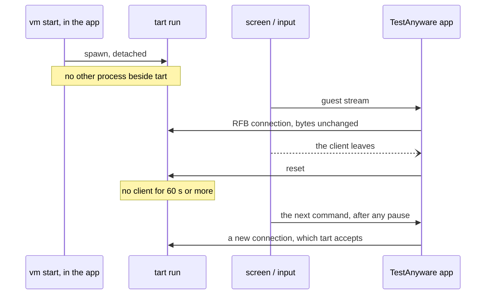

# 18. A macOS host runs the latest macOS 27 and tart, so a tart guest needs no VNC keeper

Date: 2026-11-21

## Status

Accepted. First recorded on 2026-10-19 in grove `gh-issue-6`, leaf `vnc-keeper-design-k19`,
when each tart guest got a VNC keeper. Reworked in grove `gh-issue-13`, leaf
`keeper-removal-k2`, when macOS 27.2.1 removed the fault and the owner set the host
requirement. The evidence is in `docs/research/tart-vnc-reconnect-crash-macos-27.md` and
`docs/research/tart-vnc-reset-drops-input-macos-27.md`.

## Context

On macOS 27.0.1 (26A434), Apple's `_VZVNCServer` aborted the tart process in two cases. In the
first, a VNC client connected 60 seconds or more after the last client left. In the second, a
client closed with unread data, so the kernel sent a reset, and the next client connected. The
VM stopped with tart. A macOS guest and a Linux guest crashed the same way, so the fault was in
the host.

Every `screen` and `input` command opens its own short-lived VNC connection (ADR-0004). So a
command after a pause killed the guest. An LLM agent often pauses that long between two
commands.

From 2.2.0 to 2.9.0, each tart-backed `vm start` started a VNC keeper. The keeper was a
detached process that held one bare TCP connection to the guest's VNC port for the life of
tart. One open connection prevented both crashes. The TestAnyware app also refused to probe
the VNC port of a tart guest that no keeper held.

On 2026-11-21 the host ran macOS 27.2.1 (26B131) with tart 2.42.0. With no holder, the idle
reproduction passed at gaps of 70 and 300 seconds. Six closes with an unread frame update each
left tart running at the next connection. The tart 2.40.1 release also passed the idle
reproduction on this host. It had crashed in every run on 27.0.1, so macOS removed the fault.

The same run measured the fault of issue #12 again. tart's VNC server drops the input that a
reset overtakes before the server reads it. macOS 27.2.1 did not remove that fault. A burst of
input that a reset followed moved nothing in 3 runs of 3.

## Decision

**A TestAnyware host on macOS runs the latest release of macOS 27 and the latest release of
tart. TestAnyware carries no workaround for a fault that those releases do not have. So no
process holds a VNC connection to a tart guest between commands.**

- The host requirement covers the host only. A guest runs the release that its golden holds.
- `vm start` starts no process beside `tart run` for a tart guest. Each command still opens its
  own connection, and the app relays it (ADR-0004).
- The app probes the VNC banner of each guest that it adopts, as it probes the agent. The probe
  reads the whole banner before it closes, because the banner is its answer.
- The fix of issue #12 stays. After the last event of an `input` command, the Host CLI waits
  until the guest shows that it read the input. The fault of that fix is still present on the
  latest host.
- That fix is also more than a workaround. RFB has no acknowledgement of input. The app resets
  the guest connection of each guest that it relays when the client leaves, and a QEMU guest
  is no exception.
- The README, the quick start and the LLM instructions state the requirement. Nothing checks
  the versions of the host at run time.
- `task vm:tart-vnc-idle-repro` stays the instrument. It passes without `HOLD=1` on a host
  that meets the requirement.

## Considered options

- **Keep the keeper as a guard that does no harm.** Rejected. It adds a process, a socket, two
  meta fields, a start-record field, a hidden command and adoption rules to each tart guest.
  They protect against a fault that the required host does not have. The owner rejected
  workarounds for a fault that the latest releases fixed.
- **Keep the keeper only on a host below macOS 27.2.1.** Rejected. A version gate needs a probe
  and a threshold. It keeps all of the code of the keeper for hosts outside the requirement.
- **Support every release of macOS 27.** Rejected. 27.0.1 has the fault, so this option needs
  the keeper.
- **Check the host versions at run time, in `doctor` or `vm start`.** Not chosen. "Latest"
  moves with each release of Apple and of Cirrus Labs. A fixed threshold goes stale, and a
  lookup of the latest release needs the network. The owner put the requirement in the docs.
- **Remove the fix of issue #12 with the keeper.** Rejected, for the reasons in the decision.
- **A host requirement, and no keeper.** Chosen.

## Consequences

- A host on macOS 27.0.1 loses a tart guest at the first VNC connection after 60 idle seconds.
  Nobody tested a release between 27.0.1 and 27.2.1. Such a host is outside the requirement.
  The troubleshooting guide names the symptom and the remedy, an update of macOS.
- For a host below the requirement, a release without the keeper can count as a breaking
  change.
- Each tart guest has one process and one socket fewer. The meta and the start record have no
  keeper fields. No code reads the state that 2.9.0 wrote. Its guests, metas and start records
  are discarded, not migrated.
- The idle reproduction guards against a later release that brings the fault back. If it fails
  without `HOLD=1`, this decision reopens. The history of this record holds the design of the
  keeper.
- The requirement names macOS 27. Before it names a new major, the idle reproduction and the
  issue #12 control must run on that major.
