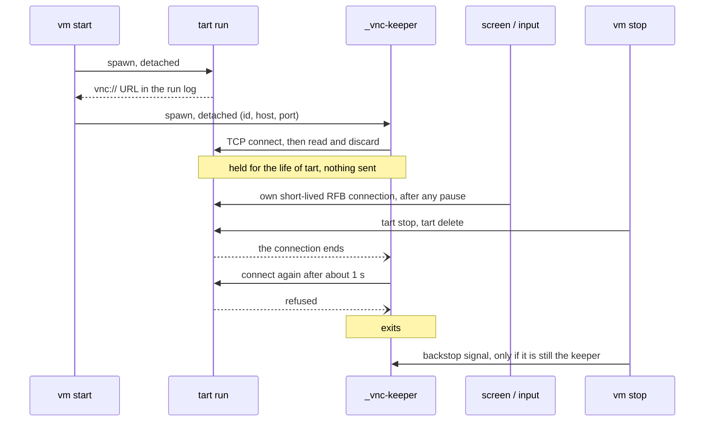

# 18. A tart guest gets a VNC keeper that holds one silent connection for its life

Date: 2026-10-19

## Status

Accepted (grove `gh-issue-6`, design leaf `vnc-keeper-design-k19`). Built in
leaf `vnc-keeper-k20`. The evidence is
`docs/research/tart-vnc-reconnect-crash-macos-27.md`.

## Context

On a macOS 27 host, Apple's `_VZVNCServer` aborts the tart process when a VNC
client connects 60 seconds or more after the last client left. The VM stops
with it. A macOS 26 guest and a Linux guest crash the same way, so the fault is
in the host. On 2026-10-19 the fault was still present on macOS 27.0.1 (26A434)
with tart 2.40.1.

Every `screen` and `input` command opens its own short-lived VNC connection
(ADR-0004). So a command that follows a pause of 60 seconds or more kills the
guest. An LLM agent often pauses that long between two commands.

One open connection prevents the crash. A bare TCP connection that sends
nothing is enough. The real CLI survived 300 seconds idle next to an `nc`
holder, and it crashed 70 seconds after the holder stopped. The server accepts
a second client while the holder is connected. The user guide documents the
holder as a manual workaround.

The research found a second trigger. A client that closes with unread data
makes the kernel send an RST. The next connection then crashes tart, even 5
seconds later.

## Decision

**Each tart-backed `vm start` starts a VNC keeper, for macOS and Linux guests
alike. The keeper is a detached process that holds one bare TCP connection to
the guest's VNC port for as long as tart runs.**

### What holds the connection

The keeper is the `testanyware` binary itself, run as the internal command
`_vnc-keeper`. The contract hides each `_` command from `--help`. The arguments
name the VM id, the VNC host and the VNC port.

The keeper connects and never writes a byte. It does no RFB handshake, so it
never sends ClientInit, never claims a session and gets no framebuffer updates.
It reads and discards all that the server sends, which is the 12-byte protocol
version. Its receive buffer is then empty, so its close sends a FIN and not the
RST that crashes tart.

### How it starts

`TartRunner::start` spawns the keeper with `spawn_detached` when the VNC URL
appears in the tart log, before the guest-IP and agent waits. The keeper runs in its own session and
writes its log to `<vms>/<id>.keeper.log`. Its pid goes into the meta of the VM
as `keeper_pid`. If the spawn fails, `vm start` prints a warning and continues.
The guest then runs as it does without a keeper.

### How it stops

The keeper stops itself. When its connection ends, it waits about one second
and connects again. When the port refuses that connection, tart is gone, and the
keeper exits. It also exits when connections keep ending within seconds of
opening, so it cannot loop without end.

So no failure path of `vm start` must clean up the keeper: stopping tart is
enough. `vm stop` stops tart first. Then it sends the recorded `keeper_pid` a
signal as a backstop, but only if that process is still the keeper for this id.
A recycled pid never gets the signal.

This second connection adds no risk over a guest with no keeper. A gap of about
one second is far below the 60-second limit. The server may also close it
because of an error. The RST finding then suggests that any next connection
crashes tart, the keeper's or a command's.

### What happens when it dies

If the keeper dies while tart runs, the guest loses its protection. It then
behaves as it did before this decision.

Nothing restarts the keeper, because a restart is a new connection. A new
connection is safe only within 60 seconds of the last client leaving. No
process watches the keeper to restart it in time. The keeper log says why it
exited. The manual `nc` recipe in the user guide still works.

### Every host, whatever its macOS version

The keeper also runs on a macOS 26 host. Nobody has tested a macOS 26 host, and
the fault may not occur there. The keeper does no harm on such a host, for the
same reasons as on 27: it claims no session and sends nothing.

A gate on the host version would need a probe and a threshold. The threshold
moves when Apple ships a fix, and a wrong gate kills VMs. To stop the keeper,
kill its process by hand. That restores the behaviour before this decision, so
no flag is necessary.

### Not in golden creation

Each golden boot is its own `tart run`, with a fresh server. The Setup Assistant
driver (`ipsw_base.rs`) and the recovery driver (`recovery.rs`) each hold one
connection for the whole boot. Neither connects again in that boot. The other
boots make no VNC connection. So the trigger cannot occur, and golden creation
starts no keeper.

### The other VNC clients

`screen record`, the embedded viewer and each command connect as before. All of
them ask for a shared session: `RfbConnection` sends the shared flag
(`testanyware-rfb/src/connection.rs`). In each measured run, the macOS 27 server
accepted a second client while a holder was connected.

The keeper cannot disturb these clients. It asks for nothing exclusive, gets no
updates and sends no input. The recovery driver runs only in golden creation,
where no keeper runs.

### What it changes in ADR-0004

ADR-0004 stands. The keeper multiplexes nothing, and no invocation attaches to
it. Each command still opens its own connection. There is no socket, no idle
timeout and no split into client and server. One sentence of ADR-0004 changes:
the keeper is persistent, so "nothing persistent" became "nothing that commands
talk to".

## Considered options

- **Do nothing, and keep the documented workaround.** A long session on a macOS
  27 host loses its guest at the first command after a pause of 60 seconds. Only
  a user who remembers the recipe avoids it. The recipe stays documented for a
  tart guest that `vm start` did not start.
- **A thread in a long-lived process.** No TestAnyware process lives as long as
  the guest. Each command exits (ADR-0004), and the viewer is optional. A
  process made for the purpose is the daemon that ADR-0004 dropped.
- **A wrapper around `tart run`.** The wrapper would be the parent of tart and
  hold the connection, so the two would share a lifetime. But the meta `pid`
  would then name the wrapper. The wrapper would also relay the tart log for the
  VNC URL poll and pass on stop signals. The golden boots share `run_detached`,
  so they would change too. A dead wrapper leaves tart as unprotected as a dead
  keeper does. That is more change for no more protection.
- **A detached keeper process.** Chosen.
- **`nc` through a shell (`tail -f /dev/null | nc`) as the keeper.** That is two
  processes and a shell. Its behaviour depends on the `nc` of each host, and it
  has no reconnect and no log. The `testanyware` binary is already on the host.
- **A keeper that completes the RFB handshake.** It needs the password, and its
  ClientInit claims a session. The research measured the bare connection with
  the real CLI.
- **A keeper only on a macOS 27 host.** Rejected for the reasons in "Every host,
  whatever its macOS version".

## Consequences

- A `screen` or `input` command after any pause no longer kills a tart guest on
  a macOS 27 host. `task vm:vnc-keeper-live` proves this on macOS 27.0.1 with tart
  2.40.1. A macOS clone survived 5 minutes with no other client, and a Linux
  clone survived 70 seconds. With the keeper killed, a macOS clone crashed after
  70 seconds, so the keeper is what protects the guest.
- Each running tart guest has one more process (`testanyware _vnc-keeper`) and
  one more socket. The meta gains an optional `keeper_pid`, and a meta without
  it still loads.
- A tart guest that `vm start` did not start gets no keeper. The recipe in the
  user guide covers it.
- Nobody has measured a hold longer than 300 seconds. If the tart server ever
  closes an idle bare connection, the keeper connects again within about a
  second.
- Nobody has run the keeper on a macOS 26 host. The first use there should check
  that `screen` commands still connect.
- The keeper can go when every supported host has a fix from Apple:
  `task vm:tart-vnc-idle-repro` then passes without `HOLD=1`. Until then it
  stays, and it does no harm.
