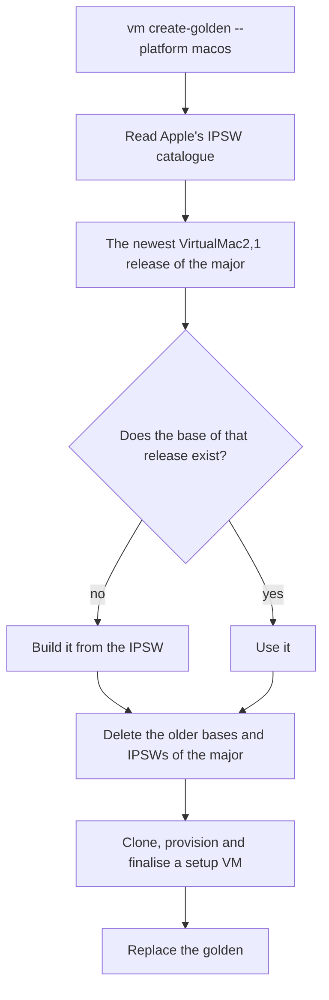

# 27. Each golden holds the latest release of its major

Date: 2026-11-21

## Status

Accepted. Recorded in grove `gh-issue-13`, leaf `golden-refresh-k3`, when the owner set the rule
for goldens.

## Context

The name of a golden names a major release: `testanyware-golden-macos-27`,
`testanyware-golden-linux-24.04` and `testanyware-golden-windows-11`. `vm start` clones the golden
of the default name when a command passes no `--base`. The owner's projects use those names.

Up to 2.9.0, a macOS golden came from a base VM named `testanyware-base-macos-<major>`. Golden
creation built that base once from Apple's IPSW and reused it in each later run. Nothing compared
the base with the current release. On 2026-11-21 the base held macOS 27.0.1, and the host ran
macOS 27.2.1.

The base build read Apple's IPSW catalogue by file name and chose the highest version of the
major. On 2026-11-21 the catalogue listed three builds of macOS 27.2.1. Only 26B131 lists the
device `VirtualMac2,1`, which is the hardware model of a virtual Mac. The other two builds serve
new Mac models only. All three have one version, so the selector chose the last one, 26B8132.

The Linux golden clones the Cirrus Labs image `ghcr.io/cirruslabs/ubuntu:<version>` and runs
`apt-get upgrade`. tart reuses an image that it cached earlier. `apt-get upgrade` holds back each
update that needs a new package, and a failed upgrade did not stop the build. The Windows golden
installs from a Microsoft evaluation ISO that a person downloads.

On 2026-11-21 the owner set the rule: keep each golden at the latest release of its major. The
owner also keeps no backward compatibility, so TestAnyware discards old bases and goldens and
migrates nothing.

## Decision

**A golden holds the latest release of its major at the time of its build. Its name names the
major only, and `vm create-golden` installs the latest release of that major. To refresh a golden,
a person runs `vm create-golden` again.**

- **macOS release.** The release is the newest one that Apple's IPSW catalogue lists for the
  device `VirtualMac2,1` in the major. If the catalogue has no such entry, golden creation fails,
  and the error names the catalogue.
- **macOS base.** The name of a base VM carries its release:
  `testanyware-base-macos-<version>-<build>`, for example `testanyware-base-macos-27.2.1-26B131`.
  So `tart list` shows the release of each base, with no boot and no second record.
- **macOS refresh.** `vm create-golden` builds the base of the latest release when that base does
  not exist. When the base is ready, the command deletes each other base of the major. It also
  deletes each cached IPSW of another release.
- **macOS plan.** `vm create-golden --dry-run` reads the catalogue and `tart list`. It names the
  release, it says whether the base of that release exists, and it names each older base that
  the run deletes.
- **Linux.** The build pulls the Cirrus Labs image again. Then it installs every pending update,
  including each update that needs a new package. A failed update fails the build.
- **Windows.** The golden holds the release of the ISO that a person supplies. TestAnyware cannot
  download that ISO. For a refresh, a person passes a current ISO with `--iso`.
- **Replacement.** A build deletes the earlier golden only when the new golden is ready. A failed
  build keeps the earlier golden.
- **No run-time check.** Nothing checks at run time whether a golden is older than the latest
  release. For macOS, `vm create-golden --dry-run` answers that question for the base.

## Considered options

- **Pin a point release in the golden name or in `--version`.** Rejected. Apple's catalogue lists
  only the releases that Apple still signs, so it cannot supply an older point release. Each
  consumer would also change its golden name at each release.
- **Keep the base name by major, and record the release in another place.** Rejected. A record
  beside the VM can disagree with the VM. A boot of the base to read `sw_vers` takes a slot and
  minutes, and a dry run cannot do it.
- **Update the base in place with Software Update.** Rejected. The base would then differ from
  Apple's restore image of one release. It also adds a second way to make a base, and the update
  service decides its result.
- **Ask Virtualization.framework for the latest supported restore image,** as `tart create
  --from-ipsw latest` does. Rejected. The answer is the newest image that the host supports, not
  an image of a major. It needs new FFI code, and a test cannot give it a fixed catalogue.
- **Select by version alone, as up to 2.9.0.** Rejected. On 2026-11-21 it chose a build for new
  Mac models instead of the build for a virtual Mac.
- **Check at `vm start` or in `doctor` whether a golden is older.** Not chosen, for the reason in
  ADR-0018. "Latest" moves with each release, and a lookup of it needs the network.
- **The latest release of the major, a base named by its release, and a refresh by
  `vm create-golden`.** Chosen.

## Consequences

- A refresh of the macOS golden downloads about 25 GB. It drives Setup Assistant once for each new
  release, and a new release can need a change to that automation (ADR-0008).
- Golden creation and its dry run read the catalogue over the network. Without the network, both
  fail with the same error. Golden creation already needed the network for Homebrew and the
  Command Line Tools.
- A consumer sees one golden name for each major. A test that needs one point release cannot pin
  it.
- The base name `testanyware-base-macos-27` of 2.9.0 counts as an older base, so the first refresh
  deletes it. A golden of a major that golden creation refuses cannot follow this rule. So
  TestAnyware keeps no such golden, and `testanyware-golden-macos-tahoe` goes.
- The Windows golden misses each cumulative update that Microsoft releases after its ISO.
  TestAnyware has no step that runs Windows Update.
- If the catalogue changes its shape, the read finds no `VirtualMac2,1` entry, and golden creation
  fails. It never falls back to another build.
