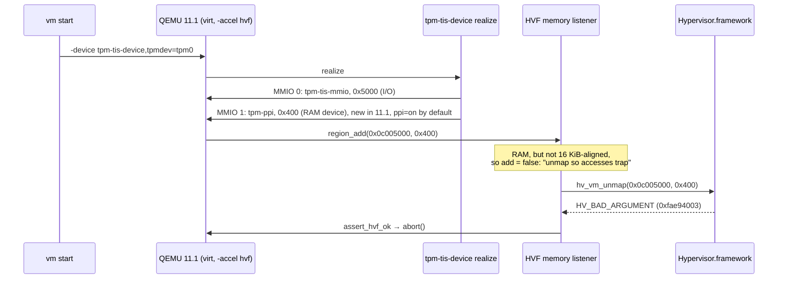

# Why Windows guests stopped starting on the macOS 27 Apple Silicon host

**Status:** investigation complete, 2026-10-18. Commissioned by the issue #6
grove (Linkuistics/TestAnyware#6), leaf `windows-tpm-on-hvf-k3`.
**Audience:** whoever implements the remedy, and anyone who later sees
`ppi=off` on the TPM device and wonders whether it can go.
**Bottom line:** two independent faults, both new since the Windows path was
last verified here in June, stacked into one symptom.

1. **QEMU 11.1.0 regression.** `tpm-tis-device` gained a 1 KiB RAM-backed PPI
   (Physical Presence Interface) region, on by default. QEMU's
   Hypervisor.framework memory listener answers any RAM region it cannot map
   whole host pages of by calling `hv_vm_unmap` on it, and Hypervisor.framework
   rejects an unaligned unmap with `HV_BAD_ARGUMENT`, so QEMU aborts at device
   realize. Turning the PPI off (`tpm-tis-device,…,ppi=off`) keeps a working
   TPM with Homebrew's QEMU. macOS 27 is not the cause.
2. **The Windows golden's `admin` password expired.** Windows' default maximum
   password age for local accounts is 42 days; the golden was built on
   2026-05-30. Auto-logon fails, the logon-triggered In-VM agent never starts,
   and `vm start` waits out its agent window. This happens with or without a
   TPM, on any host.

The decision these findings support is recorded in
[ADR-0017](../adr/0017-qemu-guest-tpm-decided-from-the-qemu-binary.md).

---

## The mechanism



`virt` places dynamic sysbus devices on its platform bus at 0x0c000000. The TIS
window takes the first 0x5000 bytes, so the PPI lands at 0x0c005000. Neither
that address nor the 0x400 size is a multiple of the 16 KiB Apple Silicon page,
and since the size is sub-page, no placement could make it one.

## Question 1 — which call fails, on what, and why

- **The call.** QEMU 11.1.2's `accel/hvf/hvf-all.c:123` is the
  `assert_hvf_ok(ret)` after `hv_vm_unmap(gpa, size)` in `hvf_set_phys_mem`'s
  `!add` branch. A RAM section reaches that branch when
  `!QEMU_IS_ALIGNED(size, page_size) || !QEMU_IS_ALIGNED(gpa, page_size)` with
  `page_size = qemu_real_host_page_size()`.
- **The region.** `hw/tpm/tpm_tis_sysbus.c` in 11.1.2 realizes a second sysbus
  MMIO when `ppi_enabled`: `memory_region_init_ram_device_ptr(…, "tpm-ppi",
  TPM_PPI_ADDR_SIZE /* 0x400 */, …)`.
- **Observed.** Homebrew 11.1.2, a paused `virt` guest, `-trace 'hvf_vm_*'`:
  the last call before the abort is
  `hvf_vm_unmap paddr:0x000000000c005000 size:0x00000400`. With `ppi=off` the
  same command stays up.
- **Why: alignment, not a new restriction.** A direct probe of
  Hypervisor.framework on this host (macOS 27.0.1, `hw.pagesize` 16384):

  | `hv_vm_unmap(ipa, size)` on a range never mapped | result |
  |---|---|
  | 0x0c005000, 0x400 (QEMU's call) | `HV_BAD_ARGUMENT` |
  | 0x0c004000, 0x400 (aligned address, sub-page size) | `HV_BAD_ARGUMENT` |
  | 0x0c005000, 0x4000 (4 KiB-aligned address, one page) | `HV_BAD_ARGUMENT` |
  | 0x0c004000, 0x4000 (16 KiB-aligned, one page) | `HV_SUCCESS` |
  | 0x0c000000, 0x8000 (16 KiB-aligned, two pages) | `HV_SUCCESS` |

  The SDK's `hv_vm.h` documents the contract, `API_AVAILABLE(macos(11.0))`:
  page-aligned `ipa`, size a multiple of the page size. The framework enforces
  exactly that, and accepts unmapping a range that was never mapped.

## Question 2 — QEMU regression, not macOS

- **Which QEMU worked in June.** Homebrew's `Formula/q/qemu.rb` history:
  11.0.1 shipped 2026-05-28 and was current through the June verification
  (30 May to 8 June); 11.0.2 came on 06-28, 11.1.0 on 08-13, 11.1.2 on 09-29.
- **Source.** `tpm_tis_sysbus.c` has no `ppi` property in 11.0.1 or 11.0.5 and
  has `DEFINE_PROP_BOOL("ppi", …, true)` in 11.1.0 and 11.1.2.
  `hvf_set_phys_mem` is identical from 11.0.1 through 11.1.2 and on QEMU master
  as fetched on 2026-10-18. Upstream history: `46cd2c10` "hw/tpm: add PPI
  support to tpm-tis-device for ARM64 virt" (so Windows 11 Arm64 guests "no
  longer log Event ID 15 errors from tpm.sys on every boot"), then `5f0348bf`
  "gate PPI support on tpm-tis-device behind a device property".
- **Run.** QEMU 11.0.1 built locally here (`--target-list=aarch64-softmmu
  --disable-pvg`; pvg must be off to compile against the macOS 27 SDK, as
  Homebrew's own formula has done since 2026-09-11) stays up on macOS 27.0.1
  with the identical TPM arguments. Its `tpm-tis-device` lists no `ppi`.

So the listener's unaligned-unmap path is old and latent; 11.1.0 exposed it by
giving the device its first sub-page RAM region. The defect is QEMU's, and
upstream has not fixed it yet.

## Question 3 — a TestAnyware-side configuration that keeps the TPM

Paused-guest checks, each spelling against both binaries:

| spelling | QEMU 11.0.1 | QEMU 11.1.2 |
|---|---|---|
| `-device tpm-tis-device,tpmdev=tpm0,ppi=off` | fails: "Property 'tpm-tis-device.ppi' not found" | stays up |
| `-global tpm-tis-device.ppi=off` | fails: same | stays up |
| `-machine virt-11.0,…` | stays up | stays up |

`virt-11.0` works because QEMU 11.1.2's `hw_compat_11_0` sets
`{ "tpm-tis-device", "ppi", "off" }`. An unconditional `ppi=off` breaks every
QEMU older than 11.1, which is why the host check below exists. Placement
cannot help (the size is sub-page wherever the region lands), and
`tpm-tis-i2c` has no I2C bus on `virt`.

**What PPI off costs the guest.** In-guest on the remedy (E1): `tpmtool`
reports a TPM 2.0 (manufacturer IBM, which is swtpm), initialized and ready for
storage, with an empty PPI version; tpm.sys logs Event ID 15 at boot. That is
the June configuration exactly, and the log noise is what upstream added PPI to
remove.

## Question 4 — Windows without a TPM, and the real blocker

Three live runs on clones of `testanyware-golden-windows-11`, all with this
branch's CLI and Homebrew QEMU 11.1.2. A `PATH` shim in front of
`qemu-system-aarch64` changed only the TPM arguments and logged every argv.

| run | TPM arguments | lock screen | logon | Healthy agent |
|---|---|---|---|---|
| E1 | triple, `ppi=off` added | ~2 min | "Your password has expired and must be changed" | 8 s after a manual password change |
| E2b | triple removed | ~2.5 min | same | 10 s after the same change |
| E3 | triple, `ppi=off` added | 136 s | same | 9 s after the same change |

The remedy's own run, on the rebuilt default golden (after the fix, on this
branch's CLI; the old golden was deleted and rebuilt under its default name):

| run | TPM arguments | logon | Healthy agent |
|---|---|---|---|
| final bar (2026-10-18) | `ppi=off`, reported `{"attached":true,"ppi_off":true}` | automatic, `admin`'s password never expires | one `vm start --platform windows`, no help over VNC |

- **The password.** The answer file's `<AutoLogon>` has no `LogonCount`;
  in-guest `AutoAdminLogon` is 1 with no `AutoLogonCount`, and `net accounts`
  shows a maximum password age of 42 days. The guest clock read 2026-10-18,
  141 days after the build. The agent is a scheduled task triggered at
  `admin`'s logon (`SetupComplete.cmd`), so without a logon there is no agent.
  The issue #3 grove's TPM-less run (835 s, last error `timeout`) is what an
  expired password produces; it said nothing about the TPM.
- **No TPM needed.** In E2b the guest really had no TPM (`tpmtool`: "The device
  is not ready for use", 0x800710df), yet booted normally and the agent came
  up. `C:` is not BitLocker-protected (`System.Volume.BitLockerProtection` = 2,
  off; `tpmtool`: "Bitlocker PCR7 Binding State: Binding Not Possible"), so
  nothing is sealed to the TPM, and no TPM-less golden is needed for a host
  that cannot supply one.
- **No licence clock.** The golden is Windows 11 Pro on the KMS-client channel
  (`slmgr /dli`: License Status "Notification"), not the time-limited
  Enterprise Evaluation, so it has no 90-day expiry. The password is the only
  age-dependent failure found.
- **A side observation.** With 11.1's ACPI the live TPM enumerates as
  `ACPI\MSFT0101\1` and a ghost `ACPI\MSFT0101\0` (status Unknown) remains from
  the June install. Harmless here.

## Question 5 — telling the hosts apart

`<qemu> -machine none -device tpm-tis-device,help` takes about 20 ms and needs
no accelerator, VM or swtpm. It answers both questions the decision needs:

- whether the binary has the `virt` TPM front end at all. QEMU prints
  "Device 'tpm-tis-device' not found" and **exits 0**, so read the text, not
  the status. `tpm-tis-device` is built only where a machine implies
  `TPM_TIS_SYSBUS` (`hw/arm/Kconfig`), so an x86_64 binary reports it absent;
- whether it has the `ppi` property (11.1+ prints `ppi=<bool> - on/off
  (default: on)`).

A version rule on `--version` is blind to distro backports (the PPI patches are
from a Red Hat engineer); a live paused-guest probe of the real arguments costs
1 to 3 s and an swtpm per start and only adds coverage for failures nobody has
seen.

## Out of scope, noted

- **Linux x86_64 hosts.** The `q35` profile also emits `tpm-tis-device`, which
  an x86_64 QEMU does not build; a TPM there would need `tpm-crb` or `tpm-tis`.
  This predates issue #6. Under the TPM decision such a host omits the TPM,
  announced, instead of failing at launch.
- **Machine-type pinning.** Pinning `virt-<version>` would freeze every
  guest-visible device default across QEMU upgrades, which goldens arguably
  want. It is a broader question than this defect.

## Reproducing

The paused-guest reproduction (swtpm behind the device, HVF calls traced):

```sh
D=$(mktemp -d); mkdir "$D/state"
swtpm socket --tpmstate dir="$D/state" --ctrl type=unixio,path="$D/sock" \
  --tpm2 --flags not-need-init &
qemu-system-aarch64 -machine virt,highmem=on,gic-version=3 -accel hvf -cpu host \
  -m 512 -S -display none -monitor none -serial none \
  -chardev socket,id=chrtpm,path="$D/sock" -tpmdev emulator,id=tpm0,chardev=chrtpm \
  -device tpm-tis-device,tpmdev=tpm0 -trace 'hvf_vm_*'
# aborts: … HV_BAD_ARGUMENT (0xfae94003, at ../accel/hvf/hvf-all.c:123)
# append ,ppi=off to the -device argument and it stays up
```

The Hypervisor.framework probe is a few lines of C calling `hv_vm_create(NULL)`
then `hv_vm_unmap` on the ranges in the table above, linked with
`-framework Hypervisor` and ad-hoc signed with the
`com.apple.security.hypervisor` entitlement.
