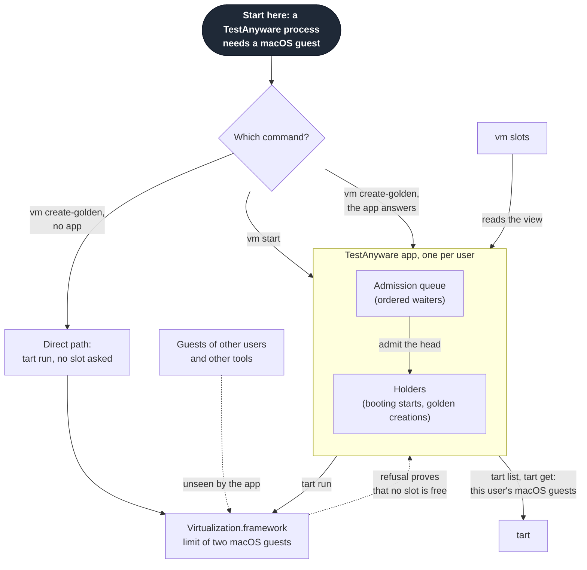
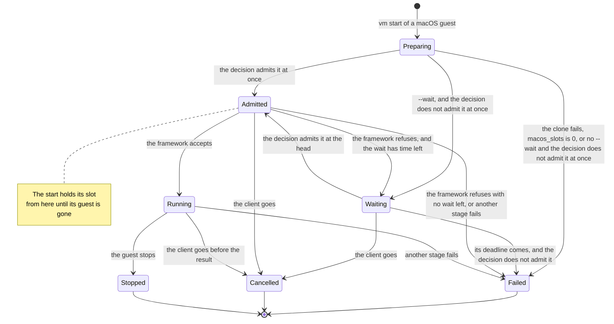
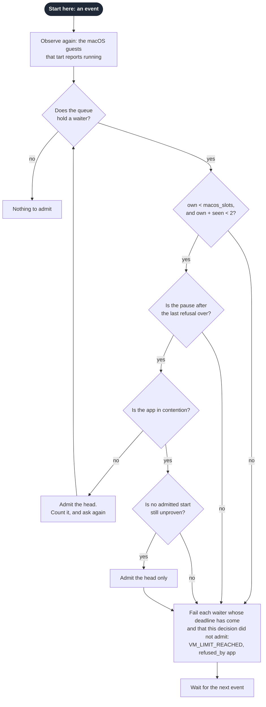
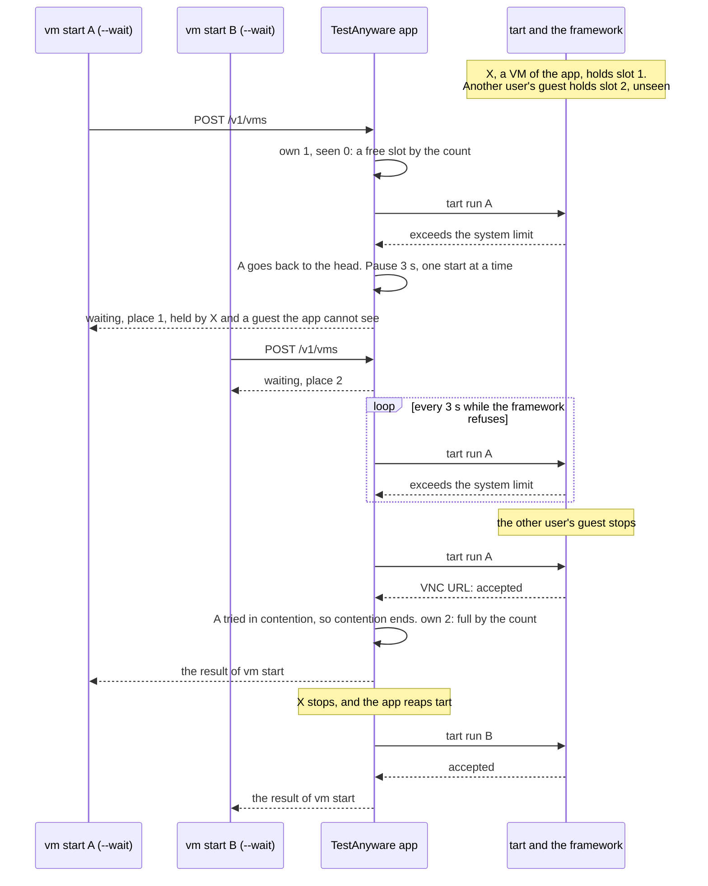
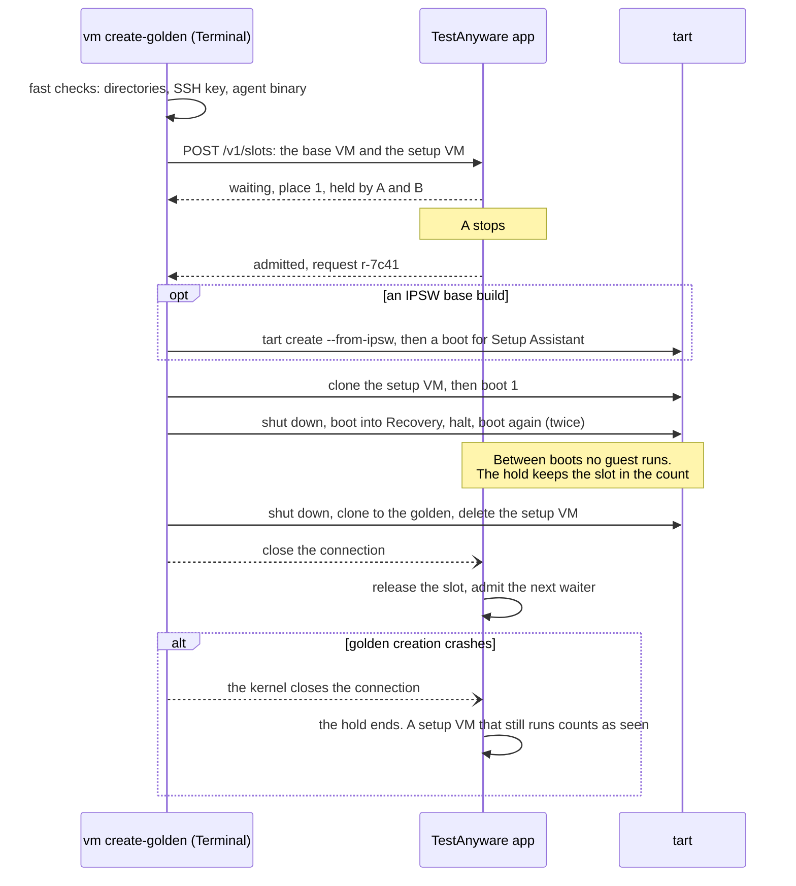
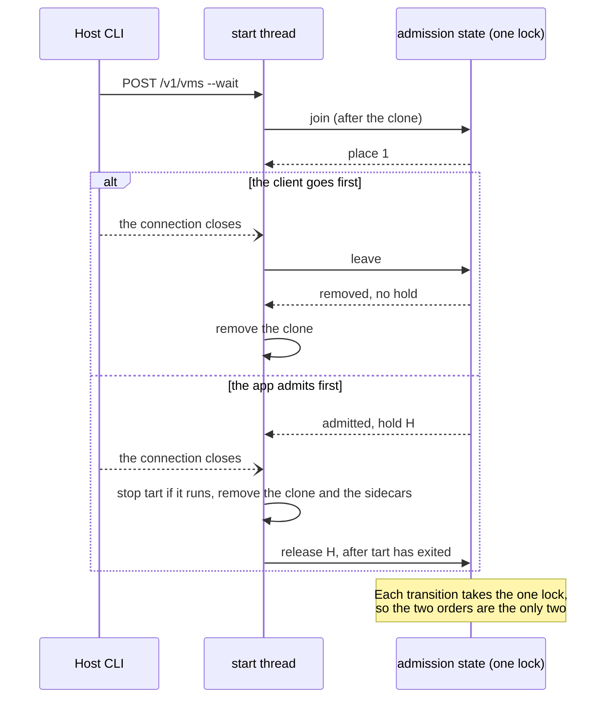
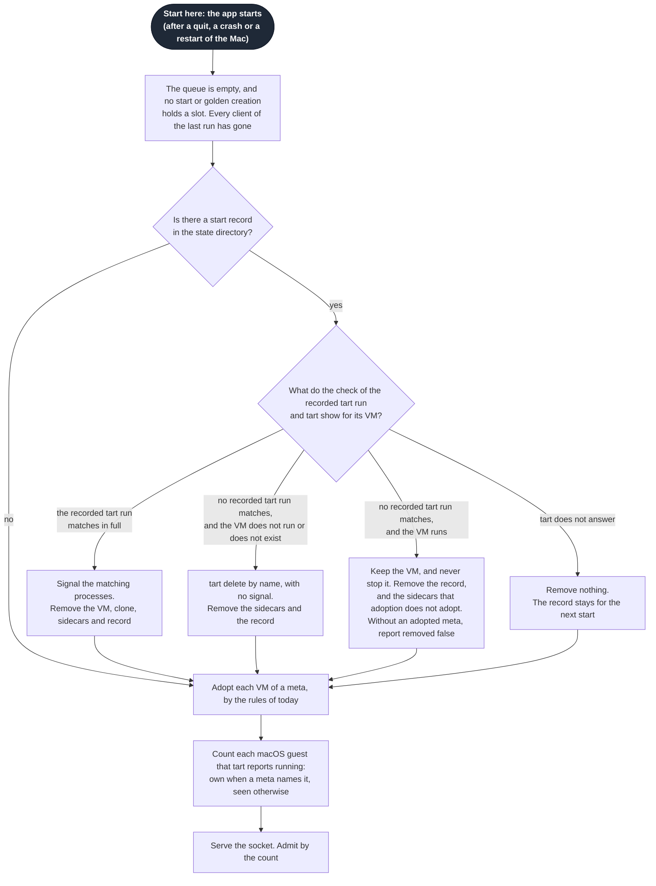

# admission-queue

This spec describes the admission queue of the TestAnyware app on a macOS host.
It covers what takes a macOS guest slot, how the app counts the slots, and the
order in which it admits starts. It covers a refusal by Virtualization.framework,
golden creation, a cancel, a crash and a restart. It also lists each addition to
the command surface. Issue #7 asks for the queue.

The spec `docs/specs/testanyware-app.md` describes the app itself: its socket,
its protocol, its lifecycle and adoption. This spec adds to that protocol and
that lifecycle, and it restates neither. These ADRs record the decisions with a
real trade-off:

- ADR-0022: the TestAnyware app admits macOS guests through one ordered queue.
- ADR-0021: one Rhai file configures the app and the Host CLI. It holds the
  slot count.
- ADR-0008: golden creation boots its setup VM five times, for the recovery
  cycle.

The evidence is the source of tart, of Orchard and of the CI runners on tart. It
also includes the reports of a stuck count of the framework. ADR-0022 cites each
source. The
owner agreed this spec on 2026-10-25. Each graph diagram starts at its dark
"Start here" node, each sequence starts at its first message, and the state
diagram starts at its initial dot.

## Problem

Apple allows two macOS guests to run at the same time on one Mac. Concurrent
groves and agents start macOS guests through the same TestAnyware app. Today
`vm start --wait` retries `tart run` every 3 s until a slot frees. The waiters
are not served in order: whichever retries first after a slot frees gets it. So
a start can wait its whole 600 s while later starts pass it.

Golden creation takes no slot from the app. A start can take the slot of a golden
creation in the gap between two of its boots. Then the next boot of golden
creation fails, after about 60 s, as a VNC boot timeout.

No process can count every running macOS guest of a Mac. `tart list` shows the
tart VMs of one user. A guest of another user or of another tool is invisible.
The contract amendment of 2026-10-19 found that only a refusal by the framework
proves that no slot is free.

TestAnyware has many client projects, and they use only its command surface. So
the queue must keep every command, flag, environment variable, VM id, exit code
and `--json` field with its meaning.

## Solution

The TestAnyware app keeps one admission queue for the macOS guest slots of its
user. A `vm start` of a macOS guest and a macOS golden creation each ask the app
for a slot. The app admits the head of the queue while its count shows a free
slot.

The count holds the guests and the starts that the app can see. A full count is
a fact, so the app admits nothing more. A free count only allows a try. When the
framework refuses the try, the start goes back to the head, ahead of each start
that joined after it. Then the app tries one start at a time, 3 s apart, until
the framework accepts one of those tries.

A start holds its slot from its admission until its guest is gone. Golden
creation holds its slot through an open connection to the app, and so between
its boots too. A start without `--wait` never waits and never passes a waiter.
Linux and Windows guests take no slot, and they start at once, as today.

The queue is never stored. Every waiter is an open connection, so a restart of
the app or of the Mac leaves no waiter behind. After a restart, the app counts
the slots again from the guests that tart reports, and from the sidecars. A new
start record lets the app remove a start that a crash of the app interrupted.

A new read-only command, `vm slots`, shows the slot count, each holder, the queue
and the last refusal.

## Decisions

### What takes a slot

These take a slot:

- a `vm start` of a macOS guest, which the tart backend runs
- a macOS golden creation, with the IPSW build of its base VM.

These take no slot, and they never wait in the queue:

- a Linux guest on tart
- a Linux or Windows guest on QEMU
- a Linux or Windows golden creation.

The framework counts macOS guests only. Maintainers of tart report three Linux
guests at once, and two macOS guests beside many Linux guests. So a Linux or
Windows start starts at once, whatever the queue holds.

The live tests of the parts of golden creation take no slot. A person runs them
by hand from Terminal. The app sees their guests as external occupancy.

### The count

The app counts two kinds of holder.

Its **own** holders are:

- each running macOS guest that has a meta in the app's state directory
- each start that the app admitted, until its guest is gone
- each golden creation that the app admitted, while its connection stays open.

Its **seen** holders are the other running macOS guests that tart reports for
the app's user. A guest that two holders name counts once. An admitted start
names its VM id. A golden creation names the base VM and the setup VM that it
runs.

The app finds the running guests with `tart list`, which reports each VM of the
user's tart storage and whether it runs. tart treats a VM as running while its
`tart run` holds a lock on the VM's configuration. So a `tart run` that crashed
shows as stopped. `tart list` does not name the OS, so the app asks `tart get`
once for each new VM name. It keeps the answer while `tart list` reports that
name. Only a guest whose OS is `darwin` counts.

The app observes again before each decision to admit, at least every 3 s while
the queue holds a waiter, and for each `vm slots` request. It never holds the
lock of the queue while tart runs. When tart does not answer within 5 s, the app
keeps its last observation that tart answered, until the next observation
answers. Before the first answer, it counts each VM of a meta as an own holder.

The count allows an admission while both hold:

- own holders < `macos_slots`
- own holders + seen holders < 2.

`macos_slots` is 2 unless `config.rhai` lowers it (see "Configuration"). The
count never proves that a slot is free. It cannot see a guest of another user or
of another tool. So a free count only allows a try, which the framework accepts
or refuses.

### The order

A start joins the queue when its clone is ready. It clones before it joins, as
it clones before its first try today. So a wrong golden name fails at once, and
not after a wait. A golden creation joins when its request arrives.

The queue holds its waiters in the order in which they joined. The app admits
only the head of the queue. It never admits a later waiter before an earlier
one. A waiter keeps its place until it leaves the queue.

A start that the framework refuses goes back into the queue at the place of its
join. So it goes ahead of each waiter that joined after it. One refused start
goes back to place 1.

The queue blocks only what the limit blocks. When the count shows two free slots,
the app admits two starts at once, and both boot together. A Linux or Windows
start never joins the queue.

Each admission request gets a stable request id from the app, such as
`r-1a2b3c4d`. The id stays the same for the whole life of the request. The app
does not reuse an id while it runs. A start without `--wait` gets an id too, so
its error can name it.

### The admission decision

One pure function decides which waiters the app admits. Its inputs are the
queue, the own holders, the seen holders, `macos_slots` and the last refusal. The
unproven starts and the time complete them. The app calls the function on each of these events:

- a start or a golden creation joins
- a waiter leaves the queue
- a holder ends
- the framework refuses a start, or it accepts one
- the pause after a refusal ends
- the deadline of a waiter comes
- a tick every 3 s while the queue holds a waiter.

First the function admits the head while the count allows, and it counts each
admission at once. In contention it admits the head only, as the next section
states. Then it fails each waiter whose deadline has come and that it did not
admit. So each waiter gets one last decision at its deadline.

The app takes one lock for each change of the queue. The changes are a join, a
leave, an admission, a refusal, an acceptance, a release and an expiry. The
decision runs
under that lock, on an observation that the app made before it took the lock.

### A refusal by the framework

The framework **accepts** a start when its `tart run` prints the VNC URL. tart
prints that URL only after the framework started the VM, so the slot is then
proven. The framework **refuses** a start when its `tart run` exits with the line
"The number of VMs exceeds the system limit". The Host CLI reads that line today.

When the framework refuses an admitted start, the app does these things:

1. Remove the start's hold. Its `tart run` has exited, so it holds no slot.
2. Put the start back at the place of its join, ahead of each waiter that joined
   after it.
3. Start **contention**, and note the time and the line of the refusal.

The app can admit two starts together, and the framework can refuse both. They
then go back in the order in which they joined, whichever refusal comes first.
So contention tries the earlier start first.

**The pause.** After each refusal, the app admits nothing for 3 s. The pause
ends at the deadline of the head when that comes first. It never blocks a start
without `--wait`, which gets its one decision at once. The pause holds whether or
not contention still holds.

**Contention.** In contention, the app admits the head alone, and only while no
admitted start is unproven. An admitted start is **unproven** until the
framework accepts it or refuses it, or until the start ends in another way. A
golden creation is never unproven. The app gets no answer from the framework
for its boots, so it would otherwise hold contention for its whole run. Each
retry is a real `tart run` on the one clone of the start, as today.

Contention ends when the framework accepts a start that the app admitted in
contention. So the app notes each start that it admits in contention.
Contention also ends when the queue holds no waiter and no admitted start is
unproven. Then the app admits by the count again, after the pause.

An acceptance of a start that the app admitted before the refusal does not end
contention. That acceptance proves only that one slot was free for that try.
The refused start still waits, and its retry has no answer yet.

So contention orders the starts exactly where the limit holds. While contention
holds, two starts never try together. So a later start can never take a freed
slot before an earlier one. A guest that the app cannot see costs one retry
every 3 s, as the retry of today does. That cost lasts until a try in
contention gets an acceptance.

A golden creation is the exception. The app sees its hold, but not its boots.
So the app can admit a start before the first boot of a golden creation, or
between two of its boots, in contention or not. Beside a guest that the app
cannot see, that start can take the one free slot. Then the next boot of golden
creation fails (see "Open risks").

### A start without `--wait`

A start without `--wait` never waits and never passes a waiter. The app admits it
at once only when all of these hold:

- the queue holds no waiter
- the count allows an admission
- contention does not block an admission.

Otherwise it fails at once with `VM_LIMIT_REACHED`, exit 6, and `refused_by`
`app`. It does not run `tart run`. When the framework refuses it after the
admission, it fails at once with `refused_by` `framework`, as it fails today.

So a slot that frees while the queue holds a waiter goes to the head of the
queue, and never to a start without `--wait`.

### The wait and its end

`--wait` keeps its meaning: bare `--wait` waits 600 s, and `--wait=<seconds>`
sets the bound. The wait counts from the moment that the start joins the queue.
Its end is the waiter's deadline.

- At its deadline, a waiter gets one last decision. The app admits it when the
  count and contention allow, as for any other decision.
- A waiter that the last decision does not admit fails with `VM_LIMIT_REACHED`,
  exit 6, and `refused_by` `app`.
- The pause after a refusal ends at the deadline of the head at the latest. So
  the pause never costs the head its last try.
- A waiter behind the head that meets its deadline during the pause gets no
  admission. It fails with `refused_by` `app`. Outside contention, only a wait
  shorter than the pause can meet this.
- The head misses its last try only when the count is full, or another admitted
  start is still unproven, at its deadline. Then it fails with `refused_by`
  `app`. The retry of today has no such case, because each start tries alone.
- A refusal at or after the deadline fails the start with `refused_by`
  `framework`.
- `--wait=0` puts the deadline at the join, so the start gets one decision. The
  app admits it when it would admit a start without `--wait`, as today.
- Once the framework accepts the start, the wait no longer applies. Boot time
  does not count against it, as today.

Any failure other than the limit, such as `TART_FAILED` or `VM_BOOT_TIMEOUT`,
ends the start at once, as today.

When `macos_slots` is 0, every macOS start fails at once with
`VM_LIMIT_REACHED` and `limit` 0, with `--wait` or without it. No slot can free
while the app runs, because the app reads the file only when it starts.

### Golden creation

On a macOS host, golden creation asks the app for a slot after its fast checks.
These are the directory check, the SSH key and the agent binary. It asks before
it changes anything. Its guest traffic keeps the direct path. The request goes
over the app's Unix socket, which Local Network privacy does not cover.

- **The app is not running, or it is not installed.** Golden creation runs as
  it does today, and it takes no slot.
- **The app answers.** Golden creation sends a hold request, which names the base
  VM that an IPSW build boots and the setup VM. It waits in the queue with no
  bound, and stderr shows its place and what holds the slots. Ctrl-C ends the
  wait.
- **The app admits it.** Golden creation runs every boot under one hold. The hold
  is the open connection, so the count keeps the slot between the boots too.
  While the count is true, no start of the app takes that slot. A guest that the
  app cannot see makes the count false (see "Open risks").
- **Golden creation ends.** It closes the connection after its setup VM has
  stopped: after the clone to the golden on success, and after its cleanup on a
  failure.
- **Golden creation crashes.** The kernel closes the connection, and the hold
  ends. A setup VM that still runs counts as a seen holder until it stops, and
  the app never stops it.
- **The app quits while golden creation holds its slot.** Golden creation goes
  on without a hold. It writes one line about it to stderr.
- **The app quits or crashes while golden creation waits.** The connection
  closes before the admission. Golden creation fails as a waiting start fails,
  and it has changed nothing yet.

The boot of a setup VM or of a base VM now notices that `tart run` exited.
Today the boot polls the log of `tart run` for 60 s for a VNC URL. When the
framework refuses a boot, golden creation tries it again 3 s later, for 30 s at
most. The framework can free the slot of the previous boot a moment after tart
exits. Then golden creation fails with `VM_LIMIT_REACHED` and `refused_by`
`framework`. This holds with the app and without it.

### A cancel

A client cancels a start when its connection closes: Ctrl-C, a killed process
or a tool call that runs out of time. The app reads the cancel at each wait of
the start, as today. The thread of the start owns the release of its slot, so the
release happens once.

| When the client goes | What the app does | The slot |
|---|---|---|
| While an earlier start of the same id runs | The start never runs | None was held |
| During the clone | The clone runs to its end, and the app then removes it | None was held |
| While the start waits in the queue | The start leaves the queue, and the app removes its clone | None was held |
| At the admission | The lock orders the two events, as the diagram below shows | Released after the cleanup |
| During the boot | The cleanup of today removes `tart run`, the keeper, the clone and the sidecars | Released after `tart run` has exited |
| After the result | Nothing changes: the VM belongs to the client | Held until the guest stops |

The app releases the slot of an admitted start only after its `tart run` has
exited. When the stop of `tart run` does not end, the slot stays held, and
`vm slots` shows it. So the app never frees the slot of a live guest.

A start takes the gate of its VM id before it joins the queue. `vm stop` takes
only that gate, and golden creation takes only the queue. So the two locks are
always taken in one order, and they cannot deadlock.

### A quit, a crash and a restart

The queue lives in memory only. Every waiter is an open connection, and a restart
of the app or of the Mac closes every connection. So after a restart the queue is
empty, and each client of the old queue got an error. No waiter is lost in
silence.

**A start record.** The app writes a start record beside the sidecars of a VM
before the clone of each start that it runs. The record names the VM id and the
backend. It also names the identity of each process that the start runs, once
that process exists: the pid, the start time and the boot session. The app removes the
record when the start ends:

- on a success, before it sends the result, because the meta then describes the
  VM
- on a failure or a cancel, after the cleanup.

A start record that the app finds when it starts names a start that a crash of
the app, or of the Mac, interrupted. No client waits for that start. So before
the app serves its socket, it decides for each such record. One pure function
makes the decision. Its inputs are the record, the identity check of each
recorded process, and the state that tart reports for the VM.

A mismatch of the identity proves only that the recorded process is gone. It
does not prove that the VM of that name is still the clone of the start. tart
names no instance of a VM, so the state of the VM decides.

Only the recorded `tart run` decides, because that process is the VM. The
keeper of the start is a separate process. It ends only when its next connect
fails (ADR-0018). So a keeper that matches proves nothing about the VM. The
first row that holds decides:

| What the app finds | What the app does |
|---|---|
| The recorded `tart run` matches in full | It removes the VM, its clone, its sidecars and the record, as the stop of the app does |
| The record names no `tart run` that matches in full. tart reports the VM as not running, or no such VM | No `tart run` holds the VM. The app removes it by name with `tart delete`, and it removes the sidecars and the record. It sends no signal |
| The record names no `tart run` that matches in full. tart reports the VM as running | The record does not prove the process that runs the VM. It can be a VM that a person made, or the start's own `tart run` before the record named it. The app sends no signal, and it runs neither `tart stop` nor `tart delete`. It keeps the VM, and it removes the record. It also removes the spec and meta sidecars, unless adoption adopts the VM by its meta |
| tart does not answer within 5 s | The app removes nothing, and the record stays |

In the second and the third row, a keeper of the start that still runs gets no
signal. It ends by itself when its port refuses.

The app never stops a running VM that the record does not prove. Sidecars that
adoption does not adopt describe a `tart run` that is gone, so the app removes
them. A meta that stayed would make the VM an own holder. `vm stop` would then
remove the VM by name.

Without the sidecars, the VM counts as a seen holder, and `vm stop` of its id
fails with `VM_NOT_FOUND`. Then no later start of the app and no `vm stop`
removes that VM. Only `tart stop` and `tart delete` remove it, or a `vm start`
whose `--id` names it (see "External occupancy").

A meta that adoption adopts belongs to an earlier start of the same id, whose
`tart run` still runs. A second start of that id writes its record before its
clone step clears those sidecars. A crash in that gap leaves the meta and the
record together. The app keeps that meta, and adoption serves the VM. The
start of the record left nothing else, so the app reports it with `removed`
true.

A start on QEMU has no tart name, and the app removes it as the stop of the app
does.

When a removal fails, the record stays, and the next start of the app decides
again. `GET /v1/status` reports each such start in its adoption results. A start
whose VM the app kept has `removed` false. Its detail names the VM, the reason,
and the remedy: `tart stop` and `tart delete` of that VM, when it is not the
person's own.

`vm list` and `vm stop` read no start record. They read the sidecars, as
today.

**A quit.** When a person quits the app, or Homebrew quits it for an upgrade, the
app first stops admitting. It cancels each waiting start, and each admitted start
that has no result yet, as a closed connection does. It waits up to 10 s for
their cleanup, and then it exits. Each client of such a start gets
`APP_UNREACHABLE` with cause `quitting`, as today. A waiting golden creation
gets the same error.

A start that the 10 s leave unfinished keeps its start record, and the next start
of the app decides for it. Each VM that started keeps running.

**A restart.** After a restart of the app, the app adopts each VM by the rules of
today. It counts each running macOS guest: as own when a meta names it, and as
seen otherwise.

After a restart of the Mac, no guest runs. Adoption reports each VM of a meta as
stopped. tart reports the clone of each start record as stopped, so the app
removes it. Nothing holds a slot.

So no restart loses a slot, and none frees the slot of a live guest. The count
after a restart comes from the guests that run, and tart reports a guest as
running while its `tart run` lives.

### External occupancy

The app never stops a guest that it did not start, with one exception that keeps
the meaning of `--id`. A `vm start` whose `--id` names such a guest removes it
before its clone, as every start of an id does today. A seen holder counts against
the two slots of the Mac and not against `macos_slots`. `vm slots` names each seen
holder with the kind `external`.

A guest of another user or of another tool is invisible to the app. A refusal by
the framework while the count shows a free slot proves such a guest, or a stuck
count of the framework. The app cannot tell the two apart. The error and
`vm slots` report the refusal with the line of tart, and the remedy names both
causes.

### Configuration

`config.rhai` gains one setting, `macos_slots`: the number of the two slots that
the app may hold.

- The value is the integer 0, 1 or 2. The default is 2. Another value or another
  type is `CONFIG_INVALID`.
- With 1, the app leaves one slot for a person's own VM or for another tool.
- With 0, the app admits no macOS start, and each one fails at once.
- The shared evaluator checks the value for the app and for the Host CLI on
  every host. So a wrong value fails the file for both, by the rules of
  ADR-0021. Only the app uses the value.
- The file that the app writes when it finds none names the setting in an
  example line that starts with `//`.

ADR-0021 records the file and its rules.

### Who asked

Each waiter and each holder that the app admitted in its current run carries
`requested_by`:

- `pid`: the pid of the client process, which the app reads from the kernel for
  the client's socket. The client cannot state a false pid.
- `cwd`: the working directory that the Host CLI states in its request. It names
  the grove's worktree. The app does not check it. An older Host CLI states none,
  and the value is then `null`.

An adopted VM and a seen holder have no `requested_by`.

### The protocol

The app's protocol range becomes 1 to 2, and so does the Host CLI's. Version 2
adds two requests. Each request of version 1 keeps its form and its answer. A
client of version 1 gets the queue too, because the app serves `POST /v1/vms` in
the same way for each version.

| Request | Version | Command | Response |
|---|---|---|---|
| `POST /v1/vms` | 1 | `vm start` | As today. The body gains the optional member `cwd` |
| `GET /v1/slots` | 2 | `vm slots` | The view that `vm slots --json` prints |
| `POST /v1/slots` | 2 | golden creation | Progress events, then an `admitted` event, then the hold until the client closes |

**`POST /v1/vms`.** The events do not change. The queue speaks through
`progress` lines, and a failure carries its details in the `error` event. An
older Host CLI fails on an event type that it does not know, so the queue adds
none. The app ignores a body member that it does not know, so an older app
ignores `cwd`.

**`POST /v1/slots`.** The JSON body has `vms`, the names of the VMs that the
golden creation runs, and the optional `cwd`. Each name must be a plain VM id,
or the request fails with `USAGE_ERROR` before the stream. The response is
`200` with NDJSON:

| `event` | Members | When |
|---|---|---|
| `progress` | `line` | Each line about the wait, as a waiting start gets it |
| `admitted` | `request_id` | The app admitted the golden creation. After it the app sends nothing more, and it holds the slot until the client closes the connection |
| `error` | `error` | The request failed, such as `VM_LIMIT_REACHED` when `macos_slots` is 0. It ends the stream |

**Version skew.** A command that needs version 2 fails with `APP_INCOMPATIBLE`,
cause `protocol`, when the app's range ends at 1. The remedy comes from the table
of skew in the app's spec. `vm slots` and golden creation need version 2. With an
older app, `vm start` works as that app does.

### The command surface

No command, flag, environment variable, VM id, exit code or `--json` field
changes its meaning. `vm start --json` and `vm list --json` gain no field.

**`VM_LIMIT_REACHED` gains details.** The code keeps exit 6. Each existing member
keeps its type:

| Member | Meaning |
|---|---|
| `platform` | As today |
| `limit` | The limit that refused: `macos_slots` when the app's share is full, and 2 otherwise |
| `holders` | The VMs that hold the slots. A refusal by the framework gives the names in the line of tart. A refusal by the app gives the app's holders |
| `tart_error` | The line of tart for the last refusal of this start by the framework. An empty string when the start ran no `tart run` |
| `request_id` | New. The request id, or `null` when no app took part |
| `place` | New. The place of the start when it failed, from 1. A start without `--wait` has the place that it would take. `null` when no app took part |
| `waited_secs` | New. The seconds that the start waited in the queue. 0 for a start without `--wait` |
| `refused_by` | New. `app` when the app refused: its count was full, or contention held the try back. `framework` when Virtualization.framework refused |

The remedy names `vm slots` and `--wait`. Sometimes the framework refuses while
the app sees no holder, or a start fails while contention holds its try back.
Then the remedy names two possible causes. Another user
or tool runs a guest, or the count of the framework is stuck until a restart of
the Mac.

**stderr while a start waits.** A waiting start writes a line when it joins. It
writes another when its place or the holders change, and every 30 s otherwise.
The line names the request id, the place, the number of waiters and what holds
the slots. After a refusal by the framework, a line says so and names the pause.

The `--json` envelope stays the final result only, as today. Golden creation
writes the same lines.

**`vm slots`.** A new read-only command in the `vm` group. It is a noun
subcommand, as `screen size` and `agent windows` are. It takes `--json`, and its
schema id is `vm-slots`. Its data:

| Member | Meaning |
|---|---|
| `slots` | The value of `macos_slots` in force |
| `limit` | 2, Apple's limit |
| `holders` | Each holder: `kind` (`vm`, `golden` or `external`), `vms`, `state` (`booting`, `running` or `held`), `request_id`, `requested_by` and `since` |
| `queue` | Each waiter, in order: `request_id`, `place`, `kind` (`vm` or `golden`), `vms`, `requested_by`, `since` and `deadline` |
| `contention` | `null`, or the last refusal: `since`, `tart_error` and `holders` |
| `observed_at` | The time of the last answer of tart |

Each time is in seconds since the Unix epoch. A member that does not apply is
`null`. On a Linux or Windows host, `vm slots` reports `slots` 0, `limit` 0 and
empty lists, and it needs no app. On a macOS host without the app, it fails with
`APP_UNREACHABLE` or `APP_NOT_INSTALLED`, as each command of the app does.

**The app's menu** shows the slots, each holder and each waiter, with its place
and who asked.

**Help and instructions.** The help of `vm start` drops the line that the
waiters are not served in order. It says that the app serves them in order, and
it names `vm slots`. The help of `vm create-golden` says that it waits for a slot
when the app runs. `llm-instructions` tells an agent to pass `--wait` for a macOS
start, to run a long wait in the background, and to read `vm slots`.
`capabilities` lists `vm slots`.

### Documents that change

- `docs/architecture/cli-design-contract.md`: the `--wait` row of the flag
  table, the `VM_LIMIT_REACHED` row and the amendment of 2026-10-19 on `--wait`.
  It also gains an amendment for the queue, and `vm slots` in two tables.
- `docs/specs/testanyware-app.md`: the protocol table, the start record, the
  quit, the menu and its "Out of scope".
- `docs/reference/env-vars.md`: its table of `config.rhai` gains `macos_slots`,
  and the rule of an absolute path names the path settings only.
- `CONTEXT.md`: *Admission queue*, *Admit*, *Holder*, *External occupancy*,
  *Contention*, *Unproven* and *Start record*.
- The help of `vm start` and `vm create-golden`, `llm-instructions`,
  `docs/reference/cli-commands.md` and the schemas under
  `docs/reference/cli-schemas/`.
- The `using-testanyware` skill in the Grove repository: a macOS start passes
  `--wait`, and a long wait runs in the background.

## Requirements

### Requirement: The app serves the waiters in order

On a macOS host, the app SHALL admit the waiters of its queue in the order in
which they joined. It SHALL admit no waiter before an earlier one.

#### Scenario: Three starts from separate shells

- **WHEN** both slots are held, and three `vm start --platform macos --wait` run
  from separate shells
- **THEN** each start reports its place, and each admission goes to the earliest
  waiter when a slot frees

#### Scenario: A start without `--wait` while a start waits

- **WHEN** a start waits in the queue, and a start without `--wait` arrives
- **THEN** the second start fails at once with `VM_LIMIT_REACHED`, exit 6,
  `refused_by` `app` and `place` 2, and it runs no `tart run`

### Requirement: The queue blocks only what the limit blocks

The app SHALL admit at once each start that the count allows, and a Linux or
Windows start SHALL never join the queue.

#### Scenario: Two starts and two free slots

- **WHEN** no slot is held, and two macOS starts arrive together
- **THEN** the app admits both at once, and both boot together

#### Scenario: A Linux start while macOS starts wait

- **WHEN** macOS starts wait, and a `vm start --platform linux` arrives
- **THEN** the Linux start starts at once

### Requirement: A start holds its slot until its guest is gone

An admitted start SHALL hold its slot from its admission until its guest is
gone. The returned VM id SHALL not release the slot.

#### Scenario: A stop admits the next waiter

- **WHEN** two started VMs hold both slots, a start waits, and `vm stop` stops
  one of the VMs
- **THEN** `vm slots` shows both VMs as holders until the stop, and the app
  admits the waiter after the stop

### Requirement: A refusal sends the start back to the head

Sometimes the framework refuses an admitted start that has time left. Then the
app SHALL put the start back ahead of each waiter that joined after it. It SHALL
try the start again after a pause of 3 s.

#### Scenario: A guest that the app cannot see

- **WHEN** the framework refuses the head although the count shows a free slot,
  and a second start waits
- **THEN** the app tries the head alone every 3 s, never tries the second start
  first, and `vm slots` shows the contention with the line of tart

#### Scenario: Two refusals of starts that the app admitted together

- **WHEN** the count shows two free slots, the app admits A and then B, and the
  framework refuses A first and B next
- **THEN** A is at place 1 and B at place 2, and contention tries A first

#### Scenario: An acceptance of a start that the app admitted before the refusal

- **WHEN** the app admits A and B together, the framework refuses A and then
  accepts B, and C waits behind A
- **THEN** contention holds after the acceptance of B. The app admits C only
  after the framework accepts a retry of A, or after A leaves the queue

### Requirement: A cancel leaks no slot and leaves no VM

A cancel before the admission, at the admission or during the boot SHALL leave
no VM, no clone and no sidecar. It SHALL leave no slot held.

#### Scenario: A cancel while the start waits

- **WHEN** the client of a waiting start ends
- **THEN** the start leaves the queue, the app removes its clone, and the places
  behind it move up

#### Scenario: A cancel during the boot

- **WHEN** the client of an admitted start ends before the result
- **THEN** the app removes the VM, its keeper, its clone and its sidecars, and it
  releases the slot after `tart run` has exited

### Requirement: A wait that runs out says that it waited

A start whose wait runs out SHALL fail with `VM_LIMIT_REACHED` and exit 6. Its
details SHALL name its request id, its place and the time that it waited.

#### Scenario: A wait of 2 s

- **WHEN** both slots are held, and `vm start --wait=2 --json` runs
- **THEN** after 2 s the start fails with exit 6, `refused_by` `app`, `place` 1
  and `waited_secs` of 2 or more, and no clone remains

#### Scenario: A last try at the deadline

- **WHEN** the framework refuses `vm start --wait=2`, and the guest that the app
  cannot see stops before the deadline
- **THEN** the app tries the start again at its deadline at the latest, and the
  start gets its guest

#### Scenario: A wait of 0 s

- **WHEN** no start waits, the count shows a free slot, and `vm start --wait=0`
  runs
- **THEN** the app admits the start at once, as it admits a start without
  `--wait`

### Requirement: Golden creation takes its slot from the queue

When the app runs, a macOS golden creation SHALL wait in the queue and SHALL hold
one slot across all its boots. Without the app, it SHALL run as it does today.

#### Scenario: Golden creation behind two VMs

- **WHEN** two VMs hold both slots, and `vm create-golden` runs from Terminal
- **THEN** it waits and reports its place, it starts after one VM stops, and no
  start takes its slot between its boots

#### Scenario: A full limit without the app

- **WHEN** the app is not running, and the framework refuses a boot of golden
  creation for 30 s
- **THEN** golden creation fails with `VM_LIMIT_REACHED` and the line of tart, and
  it removes its setup VM

### Requirement: A crash or a restart keeps the count true

This requirement covers a crash of a client or of the app, a quit of the app and
a restart of the Mac. After each one, the app SHALL lose no slot, and SHALL free
the slot of no live guest. It SHALL stop no VM that it did not start.

#### Scenario: The app crashes during a boot

- **WHEN** the app is killed while a start boots, after the start record names
  its `tart run`, and the app then starts again
- **THEN** the app removes that start's VM, clone and sidecars before it serves
  its socket

#### Scenario: A VM that replaced the clone of a start record

- **WHEN** the app is killed while a start boots, or after the start wrote its
  meta and before it removed its start record. Then a person stops and removes
  that VM with tart, and runs a new VM under the same name
- **THEN** at its next start the app never stops that VM, and it reports the
  start with `removed` false. No sidecar names the VM, so `vm slots` shows it
  with the kind `external`, and `vm stop` of its id fails with `VM_NOT_FOUND`

#### Scenario: A quit while starts wait

- **WHEN** a person quits the app while starts wait and one start boots
- **THEN** each client fails with `APP_UNREACHABLE` and cause `quitting`, no
  clone or VM of those starts remains, and each VM that started keeps running

### Requirement: External occupancy counts

The app SHALL count each running macOS guest of its user that it did not start,
and it SHALL never stop one.

#### Scenario: A `tart run` outside the app

- **WHEN** a person runs `tart run` for a macOS VM from a shell, and one start
  holds the other slot
- **THEN** the next start waits, `vm slots` shows the VM with the kind
  `external`, and the app never stops it

### Requirement: `config.rhai` lowers the share

The app SHALL hold at most `macos_slots` slots.

#### Scenario: One slot

- **WHEN** `macos_slots` is 1, and a start of the app holds a slot
- **THEN** a second start waits, although the framework has a free slot

#### Scenario: No slot

- **WHEN** `macos_slots` is 0, and `vm start --platform macos --wait` runs
- **THEN** it fails at once with `VM_LIMIT_REACHED` and `limit` 0

### Requirement: `vm slots` shows each waiter and each holder

`vm slots --json` SHALL show each holder and each waiter, with its request id,
its place, who asked and what holds the slots.

#### Scenario: Agents in two worktrees

- **WHEN** agents in two worktrees each run `vm start --wait`, and both slots are
  held
- **THEN** `vm slots --json` lists both waiters in order, each with its pid and
  its worktree as `cwd`

## Test seams

The human agreed these three seams in `plan-k1`. They are the seams of the app's
spec, and each one grows.

- **The protocol of the app.** A test starts the app in its test mode and drives
  it with several real Host CLI processes at once. A fake `tart` counts its
  guests against a capacity and refuses as Virtualization.framework does: its
  `tart run` writes the line of the limit and exits. Its `tart list` and
  `tart get` report its VMs and their OS.

  A capacity below the count of the fake's visible guests stands for a guest
  that the app cannot see. A fake guest that the test starts outside the app
  stands for external occupancy.

  The seam covers the order of service and a wait that runs out. It covers a
  cancel before the admission, at the admission and during the boot. It covers a
  lower `macos_slots`, external occupancy and a refusal while the app counts a
  free slot. Golden creation's hold request runs through the Host CLI's library.
  A quit of the app while starts wait, and a kill of the app during a boot
  followed by a new start, complete it. So does a VM that replaced the clone of
  a start record while the app was down, also after the start wrote its meta.
- **Pure functions.** The admission decision is a function of the queue, the
  holders, the observation, `macos_slots`, the last refusal and the time. Its
  tests cover each event: a join, a leave, an admission, a refusal and an
  acceptance. They cover a release, the end of a pause, a tick, a deadline and
  an expiry. They also cover two refusals of starts that the app admitted
  together, a last try at a deadline and `--wait=0`. One test accepts a start that the app admitted before the
  refusal. Another admits a start beside a golden creation in contention.

  Other pure functions build the count with its rule for names that two holders
  share, and the details of `VM_LIMIT_REACHED`. The last are the lines on
  stderr, the check of `macos_slots`, and the decision for a start record that
  the app finds. The tests of that decision cover each row of its table. They
  also cover a start record beside the meta of its own start, or of an earlier
  start of the same id. Another test has a keeper that matches while its
  `tart run` does not.
- **The Taskfile live checks on this Mac.** Three real macOS starts with `--wait`
  run from separate shells. A `tart run` outside the app counts as occupancy,
  and a golden creation waits for its slot.

## Open risks

- **A stuck count of the framework.** On macOS 26.x the count of the framework
  sometimes stays up after a guest stops. Only a restart of the Mac clears it
  (Apple forum threads 809815 and 830119, tart issue 1217). The app then sees
  contention with no holder that it can see. Each waiter fails at its deadline,
  and the remedy names a restart of the Mac. The app cannot tell this fault from
  a guest of another user.
- **A slot that frees late.** The framework can free a slot a moment after
  `tart run` exits. No source measured the delay. A start that the app admits at
  once after a release can then get one refusal and one pause of 3 s.
- **Two tries at once.** tart releases its own lock before it starts the VM, so
  two `tart run` can reach the framework together. When the app admits two starts
  and a guest that it cannot see holds one slot, the second waiter can win. The
  order then breaks by one place, until the refusal starts contention.
- **A crash between the start record and the result.** The app removes the start
  record before it sends the result. A crash between the two leaves a started VM
  that no client knows. `vm list` shows it, and `vm stop` stops it.
- **A VM that does not run, under the name of a start record.** While the app is
  down, a person can remove the clone of an interrupted start. The person can
  then make a VM under its name and leave it stopped. tart names no instance of a VM, so the app cannot tell the two
  apart. Its next start removes that VM by name. A proof would need a read of
  tart's own storage. The app never stops a running VM of that name.
- **A crash before the start record names its `tart run`.** The app writes the
  identity of a `tart run` into the record after the spawn, and each retry
  opens that gap again. A crash in the gap leaves a running VM that no record
  proves, so the next start of the app keeps it. Until the boot ends no meta
  exists, so `vm stop` cannot stop it. The VM counts as an external holder,
  and its report names `tart stop` and `tart delete` as the remedy.
- **A golden creation beside a guest that the app cannot see.** The app counts
  the slot of a golden creation, but it cannot see when its boots meet the
  framework. So the app can admit a start before the first boot of a golden
  creation, or between two of its boots, in contention or not. When a guest
  that the app cannot see holds the other slot, that start can take the one
  free slot. Then the next boot of golden creation gets refusals for 30 s.
  Golden creation fails with `VM_LIMIT_REACHED` and `refused_by` `framework`,
  and it removes its setup VM. A person runs it again. In the supported
  deployment, only a guest of another tool, or the stuck count of the
  framework, has this effect.
- **A golden creation without a hold.** When the app quits while golden creation
  holds its slot, golden creation goes on without one. A start can then take the
  slot between its boots, and its next boot fails with `VM_LIMIT_REACHED`.
- **An upgrade during a wait.** A cask upgrade quits the app, so each waiting
  start fails with `APP_UNREACHABLE` and cause `quitting`, and it loses its place.
- **`macos_slots` and an older release.** A Host CLI or an app of an older
  release reads `macos_slots` as an unknown key, and it fails with
  `CONFIG_INVALID`. The written file names the key only in a comment.

## Out of scope

- **A queue for every user of a Mac.** The human chose one user per Mac. The
  documents state that this is the supported deployment.
- **Fairness between groves or owners, and leases.** Issue #10 owns them.
- **Reuse of a VM within a grove.** Issue #9 owns it.
- **Budgets for CPU, memory and disk, and routing by capability.** Issue #11 owns
  them.
- **More Macs, and the choice of a host.** Issues #4 and #5 own them.
- **A stored queue.** A waiter is a connection, and a restart closes it. Issue
  #10 owns durable jobs.
- **A client that joins the queue again after a restart of the app.** It would
  need a new clone and a new place.
- **A count of every guest of the Mac.** No source shows a way to count another
  user's guests, or to tell a macOS guest from a Linux guest by its process.
- **A remedy for the stuck count of the framework.** Only Apple can fix it.
- **Evidence of each boot of a golden creation.** Golden creation could report
  its boots over its hold, or the app could trust the lock of tart as proof of a
  boot. Either would let the app protect golden creation from a guest that it
  cannot see. That risk needs such a guest, and golden creation then fails with
  a clear error. So this design takes neither.
- **A slot for the live tests of the parts of golden creation.** A person runs
  them by hand, and the app counts their guests as seen.
