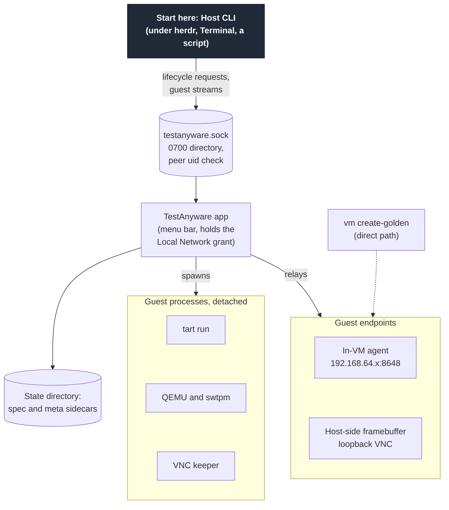
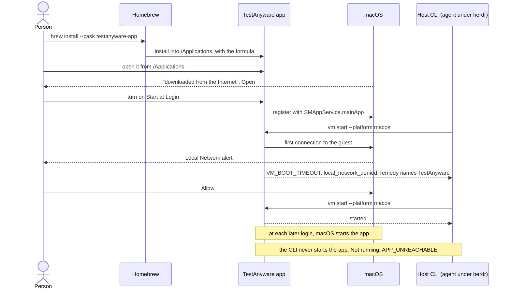
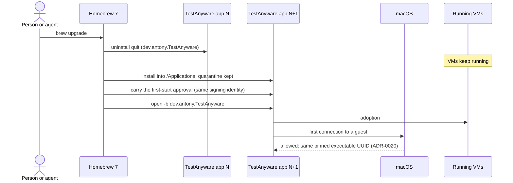
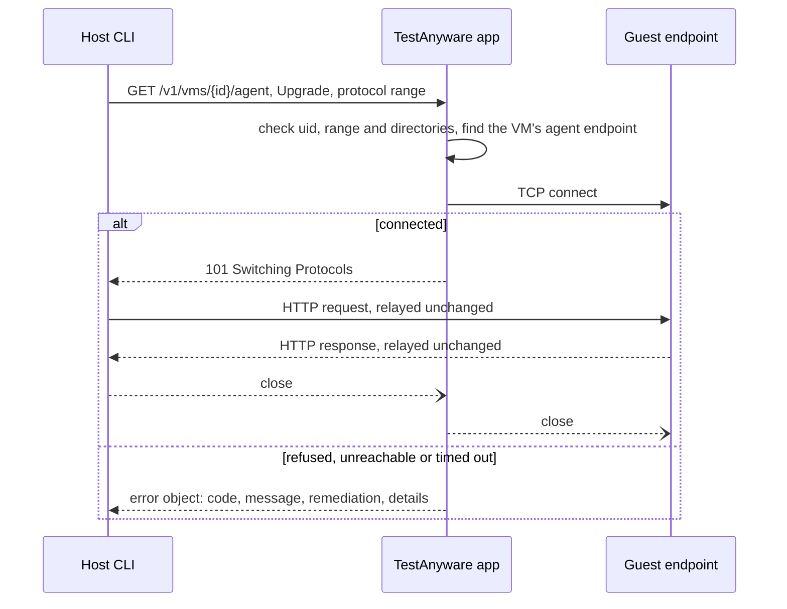
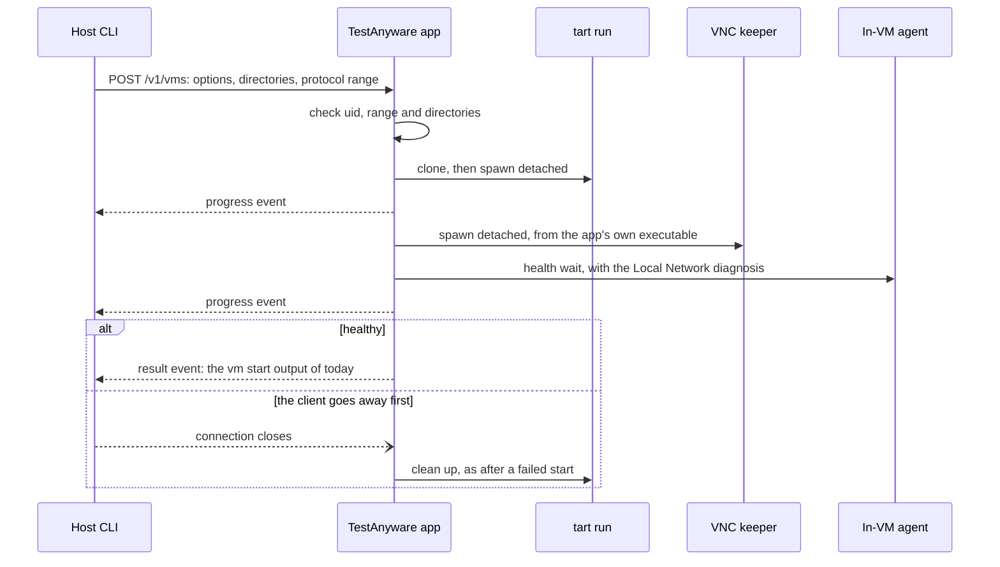
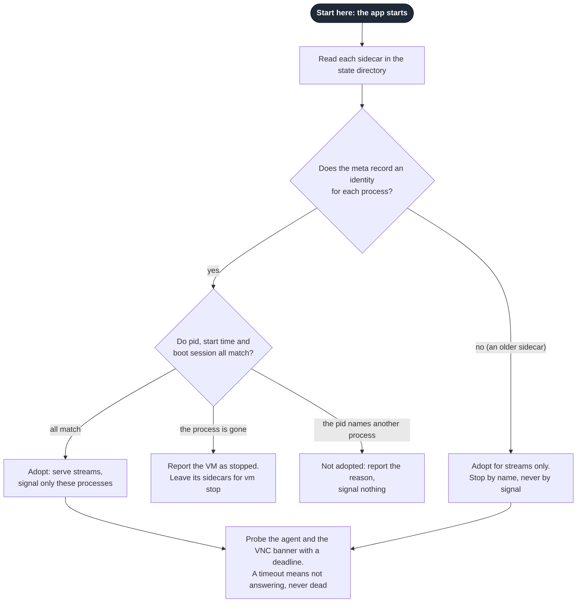
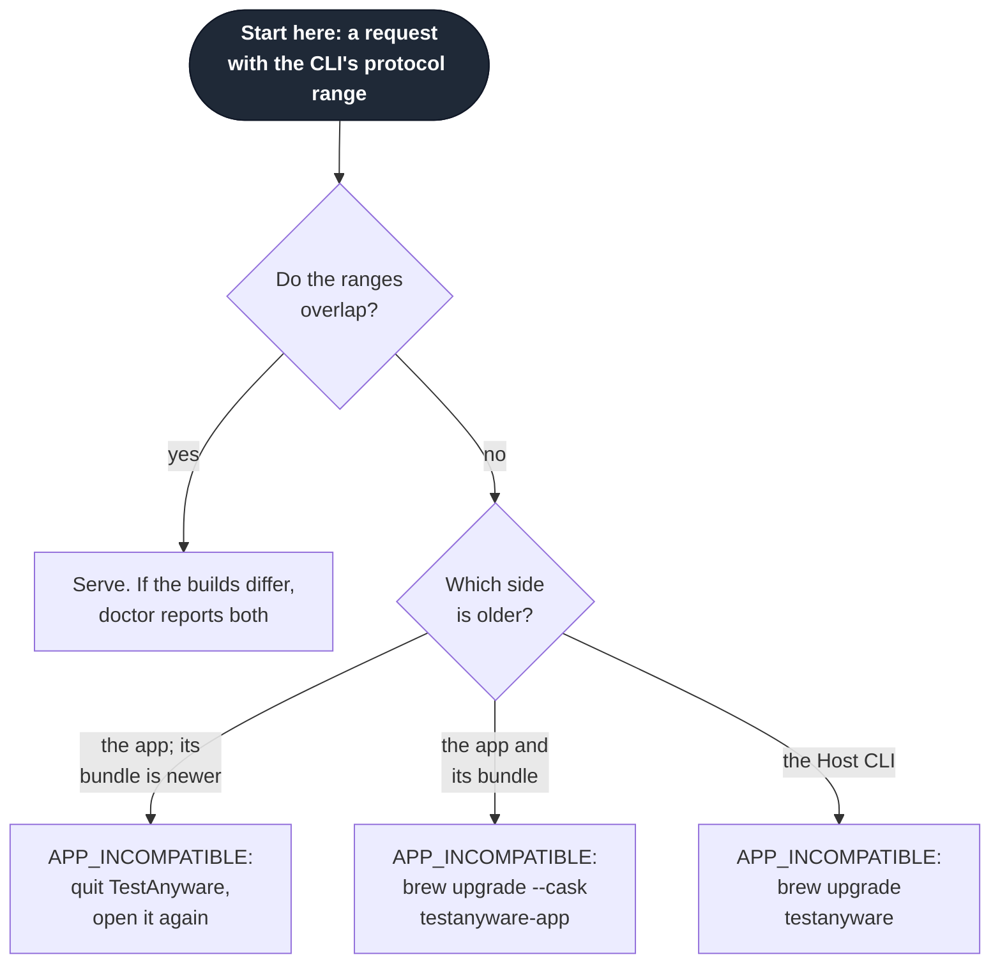
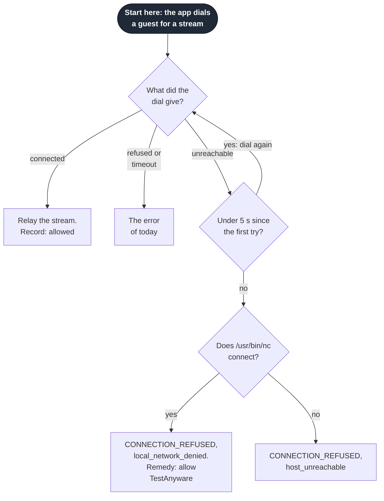
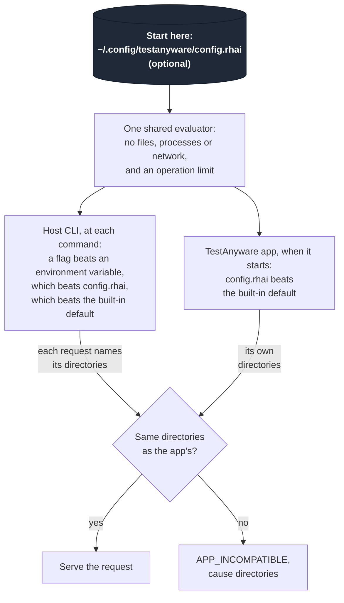

# testanyware-app

This spec describes the TestAnyware app on a macOS host. It covers how the app
ships and starts, and who can reach it. It covers how the app
carries guest traffic, keeps VMs and settles version skew. It also covers the
configuration and what the commands report. Four ADRs record the decisions in
this area that have a real trade-off, and this spec cites them:

- ADR-0004: each command opens its own guest connections, and on macOS the
  TestAnyware app relays each one.
- ADR-0019: the TestAnyware app holds the Local Network grant, and a denial is
  diagnosed where the connection is made.
- ADR-0020: the TestAnyware app keeps one executable UUID and ships as a cask.
- ADR-0021: one Rhai file configures the TestAnyware app and the Host CLI.

The evidence is in `docs/research/vm-broker-prior-art-a.md`, the survey, and in
`docs/research/testanyware-app-local-network-grant.md`, the measurements on this
Mac. The owner agreed this spec on 2026-10-20. Each graph diagram starts at its
dark "Start here" node, and each sequence starts at its first message.

## Problem

On a macOS 27 host, Local Network privacy refuses a process the route to a tart
guest's subnet. Only an exempt process, or one that the user allows, gets it.
An agent harness such as herdr runs under a login service, and nothing in that context
is an app that the user can allow. So an agent under herdr cannot start or drive
a macOS guest. ADR-0019 made that failure fast and named its cause, but it could
not remove the failure.

TestAnyware has many client projects, and they use only its command surface.
So a solution must keep every command, flag, environment variable, VM id, exit
code and `--json` field with its meaning.

## Solution

On a macOS host, a signed menu bar app, the TestAnyware app, holds the Local
Network grant. The Host CLI never connects to a guest itself. It connects to the
app on a Unix socket that only its user can open. Local Network privacy does not
cover a Unix socket.

The app runs the four lifecycle commands: `vm start`, `vm stop`, `vm list`
and `vm delete`. For every other command, the Host CLI keeps all of its protocol
work. Each agent or VNC connection of the command becomes a guest stream. A
guest stream is one connection to the app. The app relays it to one guest
endpoint with the bytes unchanged.

Golden creation keeps the direct path on every host. Linux and Windows hosts
have no TestAnyware app, and they keep the direct path for every command.

## Decisions

### The TestAnyware app

The app is a menu bar app, as Modaliser and Koine are. It sets `LSUIElement` and
shows one status item. It is not background-only. The survey reports that a
background-only app never receives the Local Network alert.

The app is one resident process for each user. Its executable comes from the
Rust workspace and links the VM lifecycle code that the Host CLI uses on other
hosts. AppKit's run loop runs on the main thread for the status item. The work
for clients and guests runs on its own asynchronous runtime. The embedded viewer
keeps its RFB work apart from its window in the same way (ADR-0005).

The status item's menu shows:

- the app's version, and whether it serves its socket
- the Local Network state: allowed, not yet seen or denied, with an item that
  opens the Local Network pane of System Settings
- the running VMs
- a "Start at Login" switch
- the configuration file, the time of its last evaluation and any error, with an
  item that opens the file
- Quit.

Quit leaves each VM running, and the menu item says so.

### How the app starts

The app starts exactly as Koine does. It is a login item through
`SMAppService.mainApp`. During setup, a person opens the app once from
`/Applications` and turns on "Start at Login". macOS then starts the app at each
later login. No client starts the app, and no client owns its lifetime. The app
does not restart itself after a crash.

When the app is not running, each command that needs the app fails with
`APP_UNREACHABLE`. The remedy says to open TestAnyware and to turn on "Start at
Login". The command never falls back to a direct connection.

The setup is one time, and a person does it:

1. Install the cask: `brew install --cask linkuistics/taps/testanyware-app`.
2. Open TestAnyware from `/Applications`.
3. Answer the "downloaded from the Internet" dialog with Open.
4. Turn on "Start at Login" in the app's menu.
5. Allow the Local Network alert when it appears.

The alert appears at the app's first connection to a guest, so step 5 can come
later than step 4. Until a person allows the alert, each guest connection fails
as "The Local Network diagnosis" below describes.

### Packaging and identity

ADR-0020 records the choices of this section and their trade-offs.

- The cask is `testanyware-app` in `linkuistics/taps`. Its `app` stanza installs
  `TestAnyware.app` into `/Applications`. It depends on the formula
  `linkuistics/taps/testanyware` and on Apple silicon.
- The bundle id is `dev.antony.TestAnyware`. The app has a Developer ID
  Application signature of team `TA43A4RUP3` and the hardened runtime. It is
  notarised and stapled, as Koine is.
- The main executable of the app carries one pinned UUID, the same value in
  every release. The build sets it before it signs the app, and the release
  checks it.
- The Host CLI's executable keeps a UUID of its own, which changes with each
  build. The two executables never share a UUID.
- A development build of the app has its own bundle id and its own pinned UUID.
  So it never shares a Local Network row with a release.
- The formula `testanyware` stays the Host CLI on macOS and on Linux. One
  release tag versions the formula and the cask together.
- The cask keeps the quarantine attribute, as Koine's does. Its `uninstall quit:`
  names the bundle id. Its zap names the app's own support and log directories
  and never the VM state.

On an upgrade, Homebrew quits the app, replaces the bundle, carries the approval
of the first start to the new copy, and opens it again. The pinned UUID keeps the
Local Network grant. Each VM keeps running while the app is down.

An existing user of TestAnyware takes one new step: the setup above.

### The socket and access

The socket is `~/Library/Application Support/TestAnyware/testanyware.sock`. Its
directory belongs to the user and has mode 0700.

- The app creates the directory with that mode. It refuses to serve when another
  user owns the directory, or when its mode admits anyone else.
- The Host CLI checks the owner and the mode of the directory before it
  connects. It refuses an unsafe directory with `APP_UNREACHABLE`.
- The socket path has 103 bytes at most. The app and the Host CLI refuse a
  longer path. Neither one truncates it.
- On each connection that it accepts, the app reads the peer's uid from the
  kernel. It closes the connection unless the uid is its own.
- Before it binds, the app removes a socket file that no process answers. A
  second process of the app exits when it finds the first one on the socket.
- The app has no TCP listener.

The app opens a guest stream only to one of two targets:

- the agent or VNC endpoint of a VM in its state directory
- an explicit endpoint that the request names, for the agent or VNC protocol.

It never opens a host file or a host socket for a client. Code in a guest never
controls the host side. An explicit endpoint can name any address. So any
process of the same user can reach any TCP address through the app's grant. That
is the purpose under herdr, and the uid check limits it to the one user.

### The protocol

The app speaks HTTP/1.1 on its socket, under the path prefix `/v1`. Every
request carries the Host CLI's protocol range and build version in its headers.
Every response carries the app's protocol range and build version.

| Request | Command | Response |
|---|---|---|
| `GET /v1/status` | `doctor` | The app's state: versions, executable path, directories, configuration, Local Network observation, login item status and adoption results |
| `GET /v1/vms` | `vm list` | The listing that `vm list` prints today |
| `POST /v1/vms` | `vm start` | Progress events as NDJSON, then one result event or one error event |
| `POST /v1/vms/{id}/stop` | `vm stop` | The result that `vm stop` prints today |
| `POST /v1/goldens/{name}/delete` | `vm delete` | The result that `vm delete` prints today |
| `GET /v1/vms/{id}/agent` or `/vnc`, with `Upgrade` | any command that reaches a VM by id | `101 Switching Protocols`, then a guest stream |
| `GET /v1/endpoints/{host}:{port}/agent` or `/vnc`, with `Upgrade` | any command with an explicit endpoint | `101 Switching Protocols`, then a guest stream |

Each lifecycle request carries the options that the Host CLI parsed, and the
state and data directories that it resolved. The app never reads a
setting from the environment of a client.

A guest stream carries the guest protocol's bytes unchanged, in both
directions:

- The Host CLI runs its agent HTTP client, or its RFB client, on the stream as it
  does on a TCP connection today. `vm start --viewer`, `viewer` and `screen
  record` run in the Host CLI on guest streams.
- Each stream has its own connection to the guest. The app opens it when
  the stream opens, and closes it when either side closes. It reuses none.
- A half-close passes through. Each relay buffer has an upper bound.
- The app sets no timeout of its own on an open stream. The Host CLI's own
  timeouts stay as they are.

An error before the upgrade is a JSON object in the Host CLI's own vocabulary:
`code`, `message`, `remediation` and `details`, with `details.cause` and
`details.errno` where they apply. The Host CLI prints it in the envelope that it
prints today, with the exit code that the code has today. A failed dial is
`CONNECTION_REFUSED` with its errno, and a dial that times out is
`CONNECTION_TIMEOUT`.

When the client's connection closes before a `vm start` result, the app
cancels the start and cleans up as it does after a failed start. `vm start
--wait` waits for a macOS guest slot in the app, and a closed connection
ends that wait.

### Lifecycle and adoption

The app runs `vm start`, `vm stop`, `vm list` and `vm delete` with the
lifecycle code that the Host CLI runs on other hosts. It starts `tart run`,
QEMU, swtpm and the VNC keeper detached in their own sessions, as `vm start` does
today. While the app runs, it reaps each of its children that exits. Each
child outlives the app, as the measurements show. The app starts each VNC
keeper from its own executable, so a keeper always matches the app's version.

The state directory stays the record of each VM, in the spec and meta sidecars
of today. The app keeps no other VM state across a restart.

Adoption is how the app serves again a VM that it did not start in its
current run. When the app starts, it reads each sidecar and checks each
recorded process by its identity. Then it serves each live VM again. A VM that an
older Host CLI started has the same sidecars, so the app adopts it in the
same way.

The rules of adoption:

- The meta records the pid, the start time and the boot session UUID of each
  process that it names. The app sends a signal to a process only when all
  three match. It writes the meta atomically.
- An older meta records no identity. The app serves the streams of such a
  VM, but it sends a signal to none of its processes. It stops a tart guest by
  name with `tart stop`, and a QEMU guest through its monitor socket.
- A failed adoption never stops, kills or starts a VM again. The app
  reports the VM as not adopted, with the reason, in `GET /v1/status` and in its
  menu. The VM keeps running.
- The app serves its socket before it probes the survivors. So a survivor
  that answers nothing never delays the app.

### Version skew

Protocol versions are integers. The first release states the range 1 to 1 on
both sides. When the two ranges overlap, the pair uses the highest common
version.

When the ranges do not overlap, the command fails with `APP_INCOMPATIBLE`. The
error names both builds and both ranges, and one remedy:

| Situation | Remedy in the error |
|---|---|
| The running app is older, and the installed bundle is newer | Quit TestAnyware from its menu, and open it again |
| The running app and its bundle are both older | `brew upgrade --cask testanyware-app` |
| The Host CLI is older | `brew upgrade testanyware` |

A client never restarts the app, so no client stops an app that other
clients use. When the builds differ and the ranges overlap, the command
proceeds. `doctor` then reports both builds, and whether the running app is older
than its bundle on disk.

The app's protocol floor rises only in a major release. A cask upgrade quits and
opens the app again, so it leaves no old app running.

### The Local Network diagnosis

ADR-0019 records this decision. The app diagnoses a denial of each
connection that it makes to a guest:

- **The health wait of `vm start`** keeps the rule of today. After five
  `host_unreachable` probes in a row, it asks the platform `/usr/bin/nc`. If `nc`
  connects, the start fails with `VM_BOOT_TIMEOUT` and `details.cause`
  `local_network_denied`.
- **A guest stream** retries a `host_unreachable` dial for 5 s at most. A new
  executable UUID gave a refusal of about 2 s in the measurements. Then the app
  asks `nc`. The error is `CONNECTION_REFUSED`, with `details.cause`
  `local_network_denied` or `host_unreachable`.

The remedy names the app: allow TestAnyware in System Settings, Privacy &
Security, Local Network, which a person does once. Before that grant, the first
guest connection raises the alert, and the command fails in about 8 s with this
remedy. It does not wait for a person to answer.

The app keeps its last observation of the grant for `doctor` and its menu.
It is allowed after a guest connection succeeds, denied after `nc` proves a
denial, and not yet seen before either.

### Configuration

ADR-0021 records this decision. One optional file,
`~/.config/testanyware/config.rhai`, configures the TestAnyware app and the Host
CLI. Only `TESTANYWARE_CONFIG`, a variable for tests, names another file or
`none`.

- The Host CLI and the app evaluate the file with one shared evaluator and the
  same limits. The script has no access to files, processes or the network, and
  it runs under an operation limit.
- The script's value is a map of settings. In this delivery the settings are
  `tools`, with the locations of `tart`, `qemu-system-aarch64` and `swtpm`, and
  `state_dir` and `data_dir`. An unknown key is an error.
- The app takes every setting. The Host CLI takes the directories on every host.
  It takes the tool locations where it runs the tools itself: on Linux and
  Windows hosts, and for golden creation.
- In the Host CLI, a flag beats an environment variable, which beats the file,
  which beats the built-in default. In the app, the file beats the built-in
  default. The app's built-in tool search covers `/opt/homebrew/bin`,
  `/usr/local/bin` and `/usr/bin`.

The app evaluates the file when it starts, and a restart of the app reloads it.
If the file fails to evaluate, the app runs with its built-in defaults. It
reports the error in its menu and through `doctor`. The Host CLI refuses to run
with a file that fails, with `CONFIG_INVALID`, the file, the line and the
message.

Each request names the directories that the Host CLI resolved. When they differ
from the app's directories, the command fails with `APP_INCOMPATIBLE` and
`details.cause` `directories`. The error names both pairs of directories. Its
remedy names `config.rhai`, the variable that differs, and a restart of the app
when the app evaluated an older file.

### New error codes

| Code | Exit | When |
|---|---|---|
| `APP_NOT_INSTALLED` | 1 | No TestAnyware app is installed on a macOS host. The remedy is the setup |
| `APP_UNREACHABLE` | 1 | Nothing answers on the app's socket. `details.cause` is `not_running`, `unsafe_socket_directory` or `quitting` |
| `APP_INCOMPATIBLE` | 1 | `details.cause` is `protocol` or `directories` |
| `CONFIG_INVALID` | 2 | `config.rhai` fails to evaluate, or it names an unknown key |

Each existing code keeps its meaning and its exit code.

### What the commands report about the app

- **`doctor`** gains an `app` check on a macOS host. It reports whether the app
  is installed, with its path and version, and whether it runs, with its build
  and protocol range. It reports the login item's status, the Local Network
  observation, the configuration, each VM that was not adopted, and whether the
  directories match. Each failing item carries a remedy. On a Linux or Windows
  host, the check reports that it does not apply. A `config` check on every host
  reports the Host CLI's own evaluation of the file.
- **`llm-instructions`** gains a section on the TestAnyware app. It covers the
  one-time setup by a person, and the rule that a client never starts the app.
  It also covers each error above with its remedy, and golden creation from
  Terminal.
- **`vm start --json` and `vm list --json`** gain no field. Each field keeps its
  meaning. An endpoint in them is the guest's own endpoint, which on a macOS host
  only the app reaches.

### Golden creation keeps its direct path

`vm create-golden` runs in the Host CLI on every host, as today. It connects to
the guest itself, through SSH, RFB and the agent, and it does not use the app.
On a macOS host it needs a context with Local Network access, such as
Terminal. Under herdr it fails as it does today.

### Linux and Windows hosts

A Linux or Windows host has no TestAnyware app. The Host CLI keeps the direct
path of today for every command. `config.rhai` applies there too.

### Documents that the implementation corrects

The code survey of 2026-10-20 found documents that this design changes, or that
are wrong today:

- `docs/reference/connection-spec.md` describes the `<id>.json` file as a
  contract for direct readers. It stops being one. It also calls the QEMU VNC
  endpoint "LAN", but QEMU listens on `localhost`.
- `docs/user/multi-vm-networking.md` puts the QEMU agent at `<vm-ip>:8648`, but
  QEMU forwards it from `localhost`.
- The doc comment of the target resolution, and `docs/reference/env-vars.md`,
  put `--agent` and `--vnc` before `TESTANYWARE_VM_ID`. The code puts the
  variable first.
- The list of error codes in the command surface omits `AGENT_INVALID_JSON`,
  which the agent client returns.

## Requirements

### Requirement: Every guest connection on a macOS host goes through the app

The Host CLI SHALL open no connection to a guest on a macOS host, except in
golden creation.

#### Scenario: An agent command from herdr

- **WHEN** an agent under herdr runs `agent snapshot --vm <id>` after the setup
- **THEN** the command succeeds through a guest stream, and the output matches the
  output of today

#### Scenario: An explicit endpoint

- **WHEN** a command names `--agent <host>:<port>` on a macOS host
- **THEN** the Host CLI asks the app for a stream to that endpoint, and it
  dials nothing itself

#### Scenario: The app is not running

- **WHEN** any command that needs the app runs and nothing answers on its socket
- **THEN** the command fails with `APP_UNREACHABLE`, names the remedy, and makes
  no direct connection

### Requirement: No client starts the app

The Host CLI SHALL never start the TestAnyware app.

#### Scenario: The app was quit

- **WHEN** a person quits the app and an agent then runs `vm list`
- **THEN** the command fails with `APP_UNREACHABLE` and `details.cause`
  `not_running`, and the app stays quit

### Requirement: Only the user who runs the app reaches it

The app SHALL serve only connections whose peer uid is its own.

#### Scenario: Another user connects

- **WHEN** a process of another local user connects to the socket
- **THEN** the app closes the connection and serves nothing

#### Scenario: Another user owns the socket directory

- **WHEN** the socket directory belongs to another user
- **THEN** the app refuses to serve, and the Host CLI fails with
  `APP_UNREACHABLE` and `details.cause` `unsafe_socket_directory`

### Requirement: VMs outlive the app

A quit, a crash or an upgrade of the app SHALL leave each running VM running.
When the app starts, it SHALL adopt each VM that its identity rules allow.

#### Scenario: A quit and a new start

- **WHEN** a person quits the app while a VM runs, and then opens the app
- **THEN** `vm list` shows the VM, and an agent command reaches it

#### Scenario: A recorded pid names another process

- **WHEN** a meta records a pid whose start time differs from the live process
- **THEN** the app reports the VM as not adopted and signals nothing

### Requirement: A version mismatch is never silent

When the protocol ranges do not overlap, the command SHALL fail with
`APP_INCOMPATIBLE` and a remedy.

#### Scenario: The running app is older than its bundle

- **WHEN** the running app's range is below the Host CLI's, and the bundle on
  disk is newer
- **THEN** the command fails, names both builds, and says to quit and open
  TestAnyware

### Requirement: A Local Network denial names the app

The app SHALL diagnose a denial of its own guest connections, and the
remedy SHALL name the TestAnyware app.

#### Scenario: Before the first grant

- **WHEN** an agent runs `vm start --platform macos` before a person allows the
  alert
- **THEN** the start fails with `VM_BOOT_TIMEOUT` and `details.cause`
  `local_network_denied` in about 8 s after the guest's address appears, and the
  remedy names TestAnyware

### Requirement: The grant survives an upgrade

A cask upgrade of the app SHALL keep the Local Network grant.

#### Scenario: An upgrade through Homebrew

- **WHEN** `brew upgrade --cask testanyware-app` installs a new release, and a
  command then reaches a tart guest
- **THEN** no alert appears, and the first connection succeeds

### Requirement: One configuration file

The Host CLI and the app SHALL evaluate `config.rhai` with one evaluator.

#### Scenario: A file that fails

- **WHEN** `config.rhai` has a syntax error
- **THEN** each command fails with `CONFIG_INVALID` and the line, and the app
  runs with its defaults and shows the error in its menu

#### Scenario: Directories that differ

- **WHEN** the Host CLI resolves a state directory that differs from the app's
- **THEN** the command fails with `APP_INCOMPATIBLE`, `details.cause`
  `directories`, both directories and the remedy

### Requirement: Linux and Windows hosts keep the direct path

The Host CLI SHALL reach guests directly on a Linux or Windows host.

#### Scenario: A Linux host

- **WHEN** a command reaches a guest on a Linux host
- **THEN** it connects as it does today, and it needs no app

## Test seams

The human agreed these three seams in `plan-k1`.

- **The protocol of the app**, the one new seam. A test starts the app's
  executable in its test mode. That mode has no status item, no login item and
  no LaunchServices. It takes a temporary socket, state directory, data
  directory and configuration file. The test drives it with the real Host CLI
  binary through `TESTANYWARE_APP_SOCKET` and `TESTANYWARE_CONFIG`, two
  variables for tests. The guests are fakes on loopback: a wiremock In-VM agent
  and a synthetic RFB server. The test writes the sidecars that name them.

  This seam covers guest streams, a half-close, a large transfer and `vm list`.
  It covers adoption from sidecars, the version handshake, and the uid and
  directory checks. It also covers the directory refusal, the configuration
  errors, and how each error maps to the envelope.
- **The existing seams of pure functions and injected probes**, for decisions
  inside the app. These are adoption by identity, the skew decision and
  the Local Network diagnosis of a guest stream. They also include the order of
  configuration sources and the checks of the socket path.
- **The existing Taskfile live checks**, for three runs on this Mac:
  - The herdr acceptance run. From a herdr session, a macOS guest starts. An
    agent, screen, input and file command each act on it, and it stops. Each
    step goes through the app.
  - The grant survives an upgrade. Release N is installed and allowed, then the
    cask installs release N+1, and the first connection succeeds with no alert.
  - VMs survive a quit of the app, and the app adopts them when it opens again.

## Open risks

- **The release build.** The probe was not notarised, quarantined or installed
  in `/Applications`. The live check of an upgrade proves the release build.
- **The one unexplained alert.** At one upgrade with a new UUID, macOS raised the
  alert again. A pinned UUID avoided it, but each row of the measurements ran
  once.
- **Homebrew's approval carry-over.** Homebrew 7.0.9 copies the approval of the
  first start when the signing identity stays the same. Nobody has tested it
  with a TestAnyware release.
- **A login item that waits for approval.** Koine never observed the status
  `requiresApproval`. `doctor` reports it with a remedy.
- **A silent stall of every stream.** This is the most frequent failure of a
  relay in the survey. One dial for each stream and the Host CLI's own timeouts bound it.
  This delivery adds no watchdog.
- **Guest endpoints on every interface.** QEMU forwards the agent port with no
  host address, and tart's VNC listened on a wildcard socket in the
  measurements. The agent's `/exec` may be reachable from the LAN. This is not
  the app's exposure, but it undermines the one-user boundary.
- **Timeouts of today.** The agent client's total timeout of 30 s ends an
  `agent wait` or a file transfer that runs longer. A guest stream changes
  nothing about that.

## Out of scope

- **Issues #7, #4 and #5:** the host-wide queue, leases, more hosts and
  placement. The app is the one point of admission on a host, and
  `config.rhai` can gain policy functions later. This delivery builds neither.
- **Golden creation through the app.** The human kept it direct.
- **The TestAnyware app on Linux or Windows hosts.** Those hosts have no Local Network
  privacy.
- **A `launchd` daemon or a root helper.** TN3179 exempts both, but the human
  chose an app that the user grants.
- **The system defaults of macOS 15.5 that exempt a network.** They need `sudo`,
  and nobody has tested them on the tart bridge.
- **A restart after a crash.** Koine promises none, and this app follows Koine.
- **A code-signature check of the Host CLI.** The survey found no gain at the
  boundary of one user.
- **A Local Network diagnosis for the SSH of golden creation.** It has none today.
- **Multiplexed streams, pooled guest connections and a stall watchdog.**
