# testanyware-app

This spec describes the TestAnyware app on a macOS host. It covers how the app
ships and starts, and who can reach it. It covers how the app
carries guest traffic, keeps VMs and settles version skew. It also covers the
configuration and what the commands report. Five ADRs record the decisions in
this area that have a real trade-off, and this spec cites them:

- ADR-0004: each command opens its own guest connections, and on macOS only the
  TestAnyware app dials a guest.
- ADR-0009: a harness runs the cross-compiled Host CLI inside native-arch
  guests, and on a macOS host it reaches them through the TestAnyware app.
- ADR-0019: the TestAnyware app holds the Local Network grant, and a denial is
  diagnosed where the connection is made.
- ADR-0020: the TestAnyware app keeps one signing identity and ships as a cask.
- ADR-0021: one Rhai file configures the TestAnyware app and the Host CLI.

The spec `docs/specs/admission-queue.md` describes the admission queue of the
app for the macOS guest slots, and ADR-0022 records its decision.

The evidence is in `docs/research/vm-broker-prior-art-a.md`, the survey, and in
`docs/research/testanyware-app-local-network-grant.md`, the measurements on this
Mac. The owner agreed this spec on 2026-10-20. On 2026-10-21 the owner set the
rule that only the app dials a guest, and the leaf `app-all-guest-traffic-k42`
applied it. On 2026-10-22 the owner asked for a file when TestAnyware finds
none, and the leaf `default-config-file-k58` designed it. Each graph diagram starts at its dark "Start here" node, and each
sequence starts at its first message.

## Problem

On a macOS 27 host, Local Network privacy refuses a process the route to a tart
guest's subnet. Only an exempt process, or one that the user allows, gets it.
An agent harness such as herdr runs under a login service, and nothing in that context
is an app that the user can allow. So an agent under herdr cannot start or drive
a macOS guest. ADR-0019 made that failure fast and named its cause, but it could
not remove the failure. The host harnesses of ADR-0009 fail in the same way,
because their test process dials its guests itself.

TestAnyware has many client projects, and they use only its command surface.
So a solution must keep every command, flag, environment variable, VM id, exit
code and `--json` field with its meaning.

## Solution

On a macOS host, a signed menu bar app, the TestAnyware app, holds the Local
Network grant. Only the app and the processes that it starts dial a guest. The
app is the only point that knows where each of its VMs runs and how to reach it.
An explicit endpoint is the one exception, which the owner kept for
compatibility: its user names the address, and the app only makes the
connection.

The Host CLI never connects to a guest itself, and neither does a test that
drives a guest. Each connects to the app on a Unix socket that only its user can
open. Local Network privacy does not cover a Unix socket.

The app runs the four lifecycle commands: `vm start`, `vm stop`, `vm list`
and `vm delete`. For every other command, the Host CLI keeps all of its protocol
work. Each agent or VNC connection of the command becomes a guest stream. A
guest stream is one connection to the app. The app relays it to one guest
endpoint with the bytes unchanged.

Golden creation keeps the direct path on every host. It is the one traffic on a
macOS host that the app does not carry. Linux and Windows hosts have no
TestAnyware app, and they keep the direct path for every command.

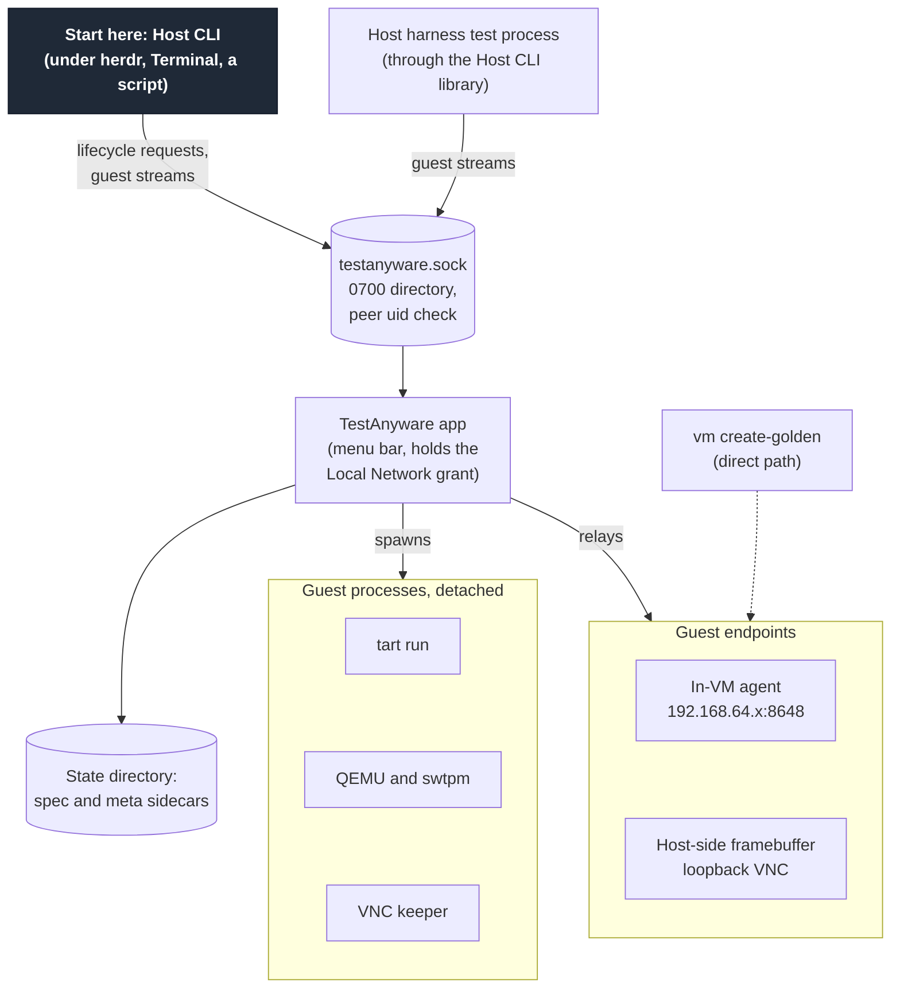

## Decisions

### The TestAnyware app

The app is a menu bar app, as Modaliser and Koine are. It sets `LSUIElement` and
shows one status item. It is not background-only. The survey reports that a
background-only app never receives the Local Network alert.

The app is one resident process for each user. Its executable comes from the
Rust workspace and links the VM lifecycle code that the Host CLI uses on other
hosts. AppKit's run loop runs on the main thread for the status item. The work
for clients and guests runs on its own asynchronous runtime. The embedded viewer
keeps its RFB work apart from its window in the same way (ADR-0005).

The status item's menu shows:

- the app's version, and whether it serves its socket
- the Local Network state: allowed, not yet seen or denied, with an item that
  opens the Local Network pane of System Settings
- the running VMs, the slots, each holder and each waiter of the admission queue
- a "Start at Login" switch
- the configuration file, the time of its last evaluation and any error, with an
  item that opens the file
- Quit.

Quit leaves each VM running, and the menu item says so. Before the app exits,
Quit cancels each start that waits or boots (`docs/specs/admission-queue.md`).

### How the app starts

The app starts exactly as Koine does. It is a login item through
`SMAppService.mainApp`. During setup, a person opens the app once from
`/Applications` and turns on "Start at Login". macOS then starts the app at each
later login. No client starts the app, and no client owns its lifetime. The app
does not restart itself after a crash.

When the app is not running, each command that needs the app fails with
`APP_UNREACHABLE`. The remedy says to open TestAnyware and to turn on "Start at
Login". When the host has no app bundle at all, the command fails with
`APP_NOT_INSTALLED`, and the remedy is the setup below. The command never falls
back to a direct connection.

The setup is one time, and a person does it:

1. Install the cask: `brew install --cask linkuistics/taps/testanyware-app`.
2. Open TestAnyware from `/Applications`.
3. Answer the "downloaded from the Internet" dialog with Open.
4. Turn on "Start at Login" in the app's menu.
5. Allow the Local Network alert when it appears.

The alert appears at the app's first connection to a guest, so step 5 can come
later than step 4. Until a person allows the alert, each guest connection fails
as "The Local Network diagnosis" below describes. An upgrade can raise the
alert again, as "Packaging and identity" below describes.

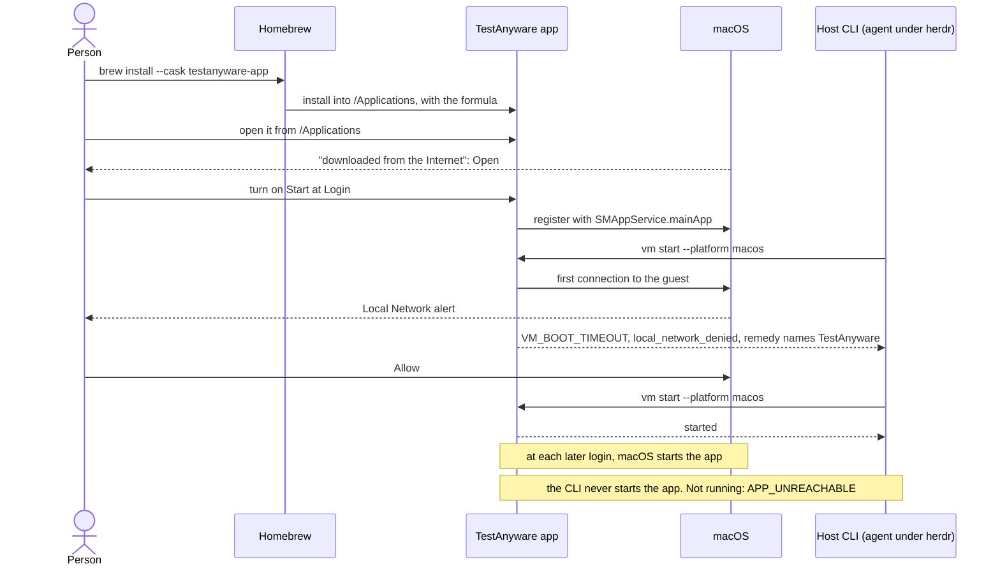

### Packaging and identity

ADR-0020 records the choices of this section and their trade-offs.

- The cask is `testanyware-app` in `linkuistics/taps`. Its `app` stanza installs
  `TestAnyware.app` into `/Applications`. It depends on the formula
  `linkuistics/taps/testanyware` and on Apple silicon.
- The bundle id is `dev.antony.TestAnyware`. The app has a Developer ID
  Application signature of team `TA43A4RUP3` and the hardened runtime. It is
  notarised and stapled, as Koine is. This signing identity stays the same in
  every release, and the release checks it.
- Each executable keeps the UUID that its link gives it, so the UUID changes
  with each build. Nothing edits a UUID. The app and the Host CLI never share a
  UUID.
- A development build of the app has its own bundle id. So it never shares a
  Local Network row with a release.
- The formula `testanyware` stays the Host CLI on macOS and on Linux. One
  release tag versions the formula and the cask together.
- The cask keeps the quarantine attribute, as Koine's does. Its `uninstall quit:`
  names the bundle id. Its zap names the app's own support and log directories
  and never the VM state.

Release 2.4.0 is the first release that ships the app. The tag `v2.4.0` names the
commit `345faf54`, the GitHub release holds the archives of the candidate, and
`linkuistics/taps` holds the formula and the cask of that build. The herdr
acceptance run passed on the app bundle and the Host CLI of the candidate on
2026-10-22. After the publication, `brew install --cask
linkuistics/taps/testanyware-app` installed the app on this Mac, and
`testanyware doctor` reported it.

Release 2.5.0 is the second release. The tag `v2.5.0` names the commit `6011dba9`.
The GitHub release and `linkuistics/taps` hold the artifacts of that build. It adds
the default `config.rhai` that the app writes at its first start. It also grows the
disk of the Linux golden to 50 GB. It closes a leak of descriptors in the guest
streams (see "The protocol" for the end of a stream).

The Linux host harness passed
on the aarch64 Linux binary of the candidate. The herdr acceptance run passed on its
app bundle, with the Host CLI of its macOS archive.

On an upgrade, Homebrew quits the app, replaces the bundle, carries the approval
of the first start to the new copy, and opens it again. Each VM keeps running
while the app is down. The unchanged signing identity keeps the app's one Local
Network row in System Settings.

The new executable UUID makes macOS evaluate the grant again. In the
measurements, the first connection after such a change failed for about 2 s. The
5 s retry of a guest stream covers that.

One change in three also raised the alert again. Then a person allows
TestAnyware once more. Until then, each guest connection fails with the denial
and its remedy, and no command waits. The owner accepts this cost of an upgrade.

The live check `release:upgrade-check` ran an upgrade of the release build once,
on 2026-10-22, on macOS 27.0.1 with Homebrew 7.0.10. It installed a notarised
release 2.3.99 from a local tap and upgraded the cask to the release candidate
2.4.0.

- The signing identity stayed the same, and the executable UUID changed.
- The quarantine flags kept the approval bit of the first start. A person
  answered the first-start dialog once, before the upgrade, and no dialog came
  after it.
- Homebrew quit the app, replaced the bundle and opened it again.
- The guest kept its tart process and its keeper, and the new app adopted it.
- The adoption probes of the new app answered, and the first command after the
  upgrade succeeded in 1 s.
- System Settings showed one row for TestAnyware.app. The rows of the
  development app and of the old probe stood beside it.

The real upgrade of this Mac from 2.4.0 to 2.5.0 is the second sample. It ran on
2026-10-24 with `brew upgrade linkuistics/taps/testanyware` and `brew upgrade
--cask linkuistics/taps/testanyware-app`, after the publication.

- The signing identity stayed the same: `dev.antony.TestAnyware`, team
  `TA43A4RUP3`, notarised. The executable UUID changed from `BC3E960A` to
  `D1773BE8`.
- The quarantine flags of the new bundle are `01c1`, which include the bit of
  the user's approval. No dialog of the first start was needed.
- Homebrew quit the app, replaced the bundle and opened it again. The guest
  `koine-verify-23707` kept its tart process and its keeper, and the new app
  adopted it.
- `testanyware doctor` reported the app as installed and running, both at build
  2.5.0, and its dial to the guest connected. The first command after the upgrade
  (`screen size`) succeeded.
- The session could not see the screen. No command failed with
  `local_network_denied`, so no alert stayed unanswered.

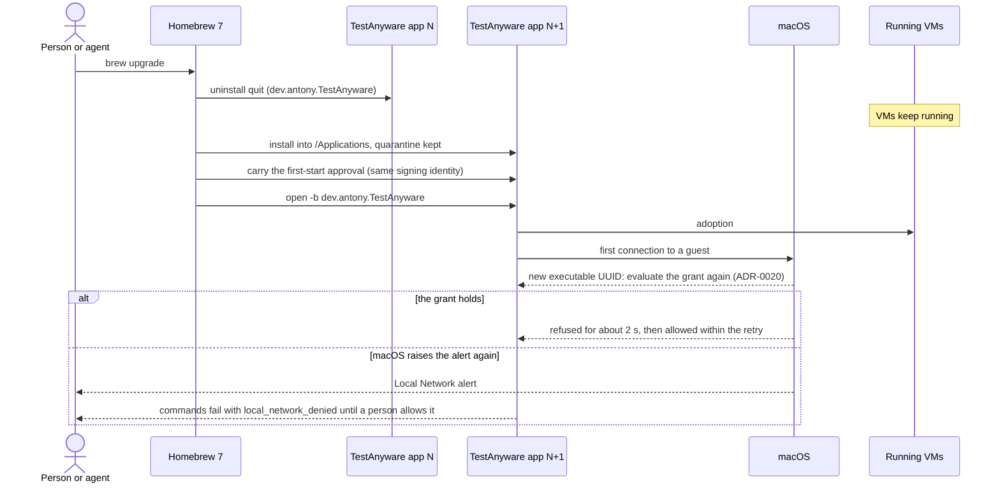

An existing user of TestAnyware takes one new step: the setup above.

### The socket and access

The socket is `~/Library/Application Support/TestAnyware/testanyware.sock`. Its
directory belongs to the user and has mode 0700.

On a macOS host, the Host CLI uses this socket unless `TESTANYWARE_APP_SOCKET` names
another one, which tests do. It builds the path from `HOME`. On a Linux or Windows
host, the Host CLI uses a socket only when that variable names one.

- The app creates the directory with that mode. It refuses to serve when another
  user owns the directory, or when its mode admits anyone else.
- The Host CLI checks the owner and the mode of the directory before it
  connects. It refuses an unsafe directory with `APP_UNREACHABLE`.
- The socket path has 103 bytes at most. The app and the Host CLI refuse a
  longer path. Neither one truncates it. The Host CLI fails with
  `APP_UNREACHABLE` and cause `socket_path_too_long`.
- On each connection that it accepts, the app reads the peer's uid from the
  kernel. It closes the connection unless the uid is its own.
- The app reads the peer's pid from the kernel in the same call. `vm slots` shows
  it as `requested_by.pid` for a start that the peer asked for.
- Before it binds, the app removes a socket file that no process answers. A
  second process of the app exits when it finds the first one on the socket.
- The app has no TCP listener.

The app opens a guest stream only to one of two targets:

- the agent or VNC endpoint of a VM in its state directory
- an explicit endpoint that the request names, for the agent or VNC protocol.

It never opens a host file or a host socket for a client. Code in a guest never
controls the host side. An explicit endpoint can name any address. So any
process of the same user can reach any TCP address through the app's grant. That
is the purpose under herdr, and the uid check limits it to the one user.

The app checks neither the port nor the protocol of an explicit endpoint. A
stream of the agent kind to port 22 relays its bytes to port 22. So only a
stream by VM id is limited to the agent and the VNC endpoint of a VM.

One user for each Mac is the supported deployment. The app serves the one user
who runs it. Its admission queue counts the tart VMs of that user only, so a
guest of another user is invisible to it (`docs/specs/admission-queue.md`).
Several users on one Mac share the two macOS guest slots of Apple, and the
framework may then refuse a start that the app admitted.

The forward of the Windows host harness is the one exception to the one-user
rule. During a manual run, another local user can reach the macOS golden
through it, by the harness's guest streams. The owner accepted this bounded
exception on 2026-10-21, and "How the host harnesses reach their guests" states
its limits.

### Guest traffic on a macOS host

ADR-0004 records this decision. The owner's rule is that the app is the only
point that knows where a VM runs and how to reach it. So on a macOS host, only the
app and the processes that it starts dial a guest. Golden creation is the one
traffic that is an exception. Every other process reaches a guest through the
app's socket.

The rule covers each VM that the app holds. On 2026-10-21 the owner kept the
explicit endpoints of `--agent`, `--vnc` and `--connect` as a compatibility
exception. With one of them, the user names the address, and the app only makes
the connection. TestAnyware's own tests and scripts name a VM only by its id.

| Traffic | What dials the guest | How the client reaches the app |
|---|---|---|
| The agent and VNC connections of a command, by `--vm`, `--agent`, `--vnc` or `--connect` | The app | A guest stream from the Host CLI |
| `vm start`, `vm stop`, `vm list` and `vm delete`, with the health wait and the resolution switch | The app | A lifecycle request from the Host CLI |
| The adoption probes and the Local Network diagnosis | The app | No client takes part |
| The VNC keeper of a tart guest, on loopback | The keeper, which the app starts from its own executable | No client takes part |
| The host harnesses of ADR-0009 | The app | Guest streams, through the Host CLI's library |
| The live checks of the Taskfile | The app | Host CLI commands |
| `vm create-golden`, with its SSH, RFB and agent connections, and the live tests of its parts | The Host CLI itself, on the direct path | No app takes part. When the app runs, golden creation asks it only for a macOS guest slot |

The processes that the app starts are the VNC keepers and the platform
`/usr/bin/nc` of the Local Network diagnosis. A live check may also ask
`/usr/bin/nc` whether its own shell can dial a guest. That probe carries no
traffic. It is a control, which shows whether a command went through the app.

A client asks for a stream by VM id, or by an explicit endpoint, as "The
protocol" below states. The app has no route for another port of a VM, such as
the SSH port 22. No client needs one. Golden creation, the one user of SSH, keeps
its direct path. The host harnesses reach their test VMs through the In-VM agent.

A stream by VM id reaches only an endpoint that the VM's spec records: its agent
or its VNC endpoint. The path names no port, so a client cannot choose another
port of the VM. An id with no spec in the state directory fails with
`VM_NOT_FOUND`, and the app dials nothing.

An explicit endpoint is the address that the user names with `--agent` or
`--vnc`, or in the spec file of `--connect`. Those flags keep their meaning, so
the app relays it as "The socket and access" above states. The app checks
neither its port nor its protocol. So only a stream by VM id is limited to the
agent and the VNC endpoint.

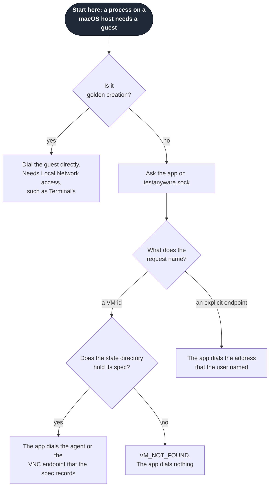

### The protocol

The app speaks HTTP/1.1 on its socket, under the path prefix `/v1`. Every
request carries the Host CLI's protocol range and build version in its headers.
Every response carries the app's protocol range and build version.

The headers are `X-Testanyware-Protocol` (a range such as `1-1`),
`X-Testanyware-Build`, and, on a request, `X-Testanyware-State-Dir` and
`X-Testanyware-Data-Dir`. A directory value is percent-encoded. A response also
carries `X-Testanyware-Bundle-Build`, the build of the app bundle on disk, when
the app can read it. A cask upgrade replaces the bundle under a running app, so
the app reads it again for each response.

A request that states no range fails as one with a range that does not overlap.
A request that states no directories fails as one with other directories. The
app compares directories as the strings it receives and canonicalises none.

| Request | Command | Response |
|---|---|---|
| `GET /v1/status` | `doctor` | The app's state: versions, executable path, directories, configuration, Local Network observation, login item status and adoption results |
| `GET /v1/vms` | `vm list` | The listing that `vm list` prints today |
| `POST /v1/vms` | `vm start` | Progress events as NDJSON, then one result event or one error event |
| `GET /v1/slots` | `vm slots` | The view of the admission queue (protocol version 2, `docs/specs/admission-queue.md`) |
| `POST /v1/slots` | golden creation | The hold of a slot (protocol version 2, `docs/specs/admission-queue.md`) |
| `POST /v1/vms/{id}/stop` | `vm stop` | The result that `vm stop` prints today |
| `POST /v1/goldens/{name}/delete` | `vm delete` | The result that `vm delete` prints today |
| `GET /v1/vms/{id}/agent` or `/vnc`, with `Upgrade` | any command that reaches a VM by id | `101 Switching Protocols`, then a guest stream |
| `GET /v1/endpoints/{host}:{port}/agent` or `/vnc`, with `Upgrade` | any command with an explicit endpoint | `101 Switching Protocols`, then a guest stream |

Each lifecycle request carries the options that the Host CLI parsed, and the
state and data directories that it resolved. The app never reads a
setting from the environment of a client.

`GET /v1/vms` carries its options in the query: `limit=N`, `all=true`, and one
`filter=field%3Dvalue` for each pair of `--filter`. A request with no `limit`
fails with `USAGE_ERROR`, and so does an option that the listing does not
know. The response is the view that `vm list` prints, as JSON: `items`,
`returned`, `total` and `truncated`. The Host CLI prints the text and the
`--json` output from that view. On a Linux or Windows host it prints them in the
same way from a view that it builds itself. The shared protocol crate holds the parser
and the builder of the query.

The app builds the view at each request, from the sidecars in its state
directory, from the clones in its data directory and from `tart list`. It finds
`tart` with its built-in tool search, and the QEMU session directories in the
temporary directory of its own process.

The app answers `GET /v1/status` for any protocol range and any directories.
That request changes nothing, and `doctor` needs it to report a mismatch. The
response keeps the app's build, protocol range and directories in the same
fields in every protocol version.

The response also holds `executable`, the path of the running executable.
`local_network` holds the observation of the grant: `state` (`not_yet_seen`,
`allowed` or `denied`), and, once the app has made one, the `destination` of
the dial and `observed_at` in seconds since the Unix epoch. `login_item` holds
the status of `SMAppService.mainApp`: `enabled`, `not_registered`,
`requires_approval` or `not_found`. A run without a login item, such as the test
mode, states `unobserved`. A reader ignores the fields it does not know, and
reads a body that lacks them.

A request for a guest stream is a `GET` that carries `Connection: Upgrade`,
`Upgrade: testanyware-stream` and the headers of the handshake. A request that
lacks the two upgrade headers, or uses another method, fails with `USAGE_ERROR`
and dials nothing. The app checks the request, finds the endpoint and dials it.
Only when the dial connects does it answer `101 Switching Protocols`, with the
same two upgrade headers.

The path grammar is exact, and the shared protocol crate holds both its parser
and its builder:

- A VM id has ASCII letters, digits, `.`, `-` and `_`, and it has no leading dot.
  The app never decodes it. Any other id fails with `VM_NOT_FOUND`, and the app
  does not look at the disk for it.
- An endpoint is `host:port`, with the port from 1 to 65535. The host is a name
  of letters, digits, `.`, `-` and `_`, or an address. An IPv6 address has
  brackets, which a path encodes as `%5B` and `%5D`. The Host CLI resolves any
  default port before it asks.

For a VM, the app reads the spec in `vms/{id}.json` of its state directory. It
takes the `agent` or the `vnc` endpoint from it. An id with no spec fails with
`VM_NOT_FOUND`, and a spec with no `agent` section fails an agent stream with
`NO_CONNECTION_SPECIFIED`. A spec that does not read fails with `IO_ERROR`. An
endpoint that does not parse fails with `INVALID_ENDPOINT`. These codes and
their messages are the ones that the Host CLI prints today.

A guest stream carries the guest protocol's bytes unchanged, in both
directions:

- The Host CLI runs its agent HTTP client, or its RFB client, on the stream as it
  does on a TCP connection today. `vm start --viewer`, `viewer` and `screen
  record` run in the Host CLI on guest streams.
- Each stream has its own connection to the guest. The app opens it when the
  stream opens. It reuses none.
- A stream ends, and the app closes its guest connection, in one of three cases:
  - Both sides have ended their direction.
  - The client has gone. It ended its direction and then closed the socket. The
    guest need not end its direction. tart's VNC server never does.
  - A read or a write fails.
- A half-close passes through. The app tells it from a client that has gone by
  the state of the client's Unix socket. A client that ended its direction and
  still reads has not gone, and it gets the guest's answer. The client's bytes
  reach the guest's connection before the stream ends, even when the client
  closes at once.
- When the client has gone, or a read or a write failed, the app resets the guest
  connection. tart's VNC server holds a connection that the app closed in the
  ordinary way in `CLOSE_WAIT` for about two minutes. A reset frees it at once.
- The app does not wait for the guest to read the client's bytes. A guest that
  reads late can drop the bytes that a reset overtakes, and tart's VNC server
  does (issue 12, `docs/research/tart-vnc-reset-drops-input-macos-27.md`). So a
  client that needs the guest to have read its last bytes waits for an answer
  of the guest before it closes. The app stays a relay of unchanged bytes, and it
  guesses no pause.
- The RFB client of the Host CLI follows that rule. After the last event of an
  `input` command, and of the menu click of `agent --open-menu`, it sends a
  FramebufferUpdateRequest for one pixel that is not incremental. It then waits
  for the FramebufferUpdate that answers it, because a server reads the messages
  of a connection in order. A wait that gets no answer ends after 10 seconds, or
  when the connection ends. The command then prints a warning on stderr and
  keeps its exit code and its output, because it sent the input.
- Each relay buffer has an upper bound.
- The app sets no timeout of its own on an open stream. The Host CLI's own
  timeouts stay as they are.

The agent client leaves reqwest, because a reqwest connector can return only
reqwest's own connection type. The agent client speaks HTTP/1.1 through hyper's
client connection, which takes any byte stream (ADR-0004). It does so on every
host, on a TCP connection or on a guest stream. It keeps each behaviour of
today:

- Each request opens its own connection, and the client closes it after the
  response. No connection serves two requests.
- The timeout covers the whole request, from the dial to the last byte of the
  body. A timeout for one request, such as the one of `exec`, replaces it.
- An upload or a download streams its body, and nothing holds the whole file
  (ADR-0001).
- Each failure keeps its code. A failed dial is `CONNECTION_REFUSED` with its
  errno. A timeout is `CONNECTION_TIMEOUT`, and a connection that ends early is
  `CONNECTION_DROPPED`. A status or an error body from the agent maps as today.
- The client follows no redirect. No In-VM agent sends one.
- The client reads no proxy variable. reqwest read `HTTP_PROXY`, and hyper does
  not. The host reaches a guest endpoint directly, on the host or on a bridge.
  A proxy has no part in that route.

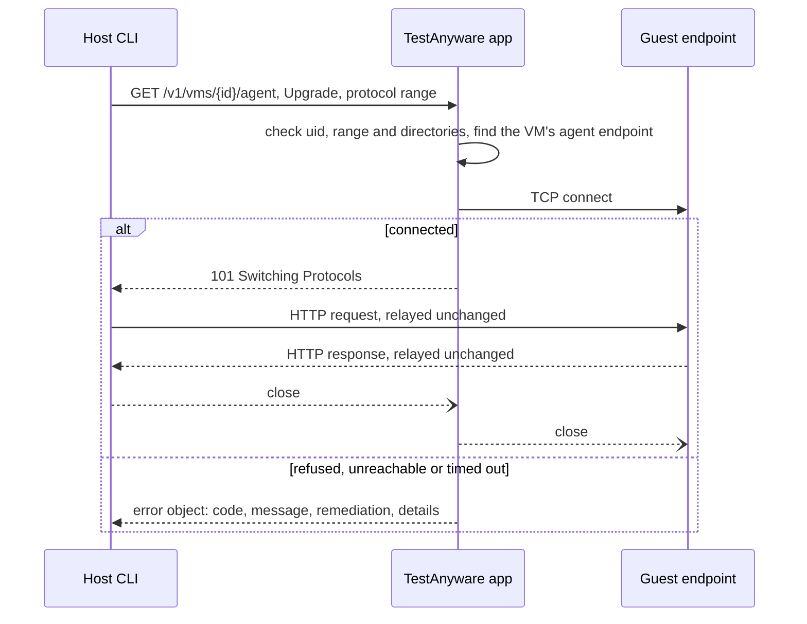

An error before the upgrade is a JSON object in the Host CLI's own vocabulary:
`code`, `message`, `remediation` and `details`, with `details.cause` and
`details.errno` where they apply. The Host CLI prints it in the envelope that it
prints today, with the exit code that the code has today. Where the app sends no
`remediation`, the Host CLI adds the remedy that the code has today. A failed dial is
`CONNECTION_REFUSED` with its errno, and a dial that times out is
`CONNECTION_TIMEOUT`.

The HTTP status is 502 for the first and 504 for the
second. It is 404 for `VM_NOT_FOUND` and for `GOLDEN_NOT_FOUND`. It is 409 for
`NO_CONNECTION_SPECIFIED` and for `GOLDEN_IN_USE`. It is 400 for
`INVALID_ENDPOINT` and for a request that lacks the upgrade headers.
It is 405 for another method, and 500 for `IO_ERROR`, `VM_STOP_FAILED` and
`TART_FAILED`. The Host CLI reads the code, never the status.

`POST /v1/vms` carries the options as a JSON body: `platform`, `base`, `id`,
`display`, `logical`, `keep_on_failure`, `wait_secs` and `cwd`. The Host CLI states
the id and the base that it chose by default, so the app reads nothing from the
environment of the client. `--viewer` is not an option of the request: the
viewer runs in the Host CLI on a guest stream after the result.

A request that the app cannot take fails before the stream, as an error object
with its HTTP status. Four requests fail in this way. An unknown platform gives
`INVALID_PLATFORM` (400). An id that is not a plain VM id, a base that is a
path, and a body that does not read give `USAGE_ERROR` (400).

The response is `200` with `application/x-ndjson`. Each line is one JSON
object with an `event` member:

| `event` | Members | When |
|---|---|---|
| `progress` | `line` | Each line that `vm start` prints to stderr today, such as the slot-wait line and the line about the resolution switch. The Host CLI prints it to stderr in both output modes. |
| `result` | `data` | The start succeeded. `data` has `id`, `platform`, `vnc`, `agent`, `spec_path`, `meta_path` and, for QEMU, `tpm`, in the form that `vm start --json` prints. It ends the stream. |
| `error` | `error` | The start failed. `error` is the object of the other routes, with the `code`, `message`, `remediation` and `details` that the direct command prints. The Host CLI prints it with the exit code of its table, and adds no default remedy. It ends the stream. |

A stream that ends with neither event means that the app went away. The Host
CLI then fails with `APP_UNREACHABLE`, cause `quitting`.

When the client's connection closes before a `vm start` result, the app
cancels the start and cleans up as it does after a failed start. `vm start
--wait` waits in the app's admission queue for a macOS guest slot
(`docs/specs/admission-queue.md`), and a closed connection
ends that wait. The app reads the cancel at each wait of the start: the slot
wait, the stages of the boot and the agent wait. It reads the cancel after
each step that runs to its end, such as `tart clone`. The cleanup removes the
VM, its VNC keeper and its sidecars, and it ignores `--keep-on-failure`,
because no client is left to reclaim a kept VM. A start that succeeded at the
moment the client left is stopped again.

The app runs each start on a thread of its own, with its own runtime, because
a start calls tools that block. It installs no signal handler: a handler in the
app would end the app. A start answers to the connection of its client only.

`POST /v1/slots` carries `vms` and the optional `cwd` as a JSON body. The
golden creation names the VMs that it boots, and each name must be a plain VM id.
A body that does not read, an empty list and a name that is not a plain VM id
give `USAGE_ERROR` (400). The response is `200` with `application/x-ndjson`, with
the events `progress`, `admitted` and `error`. After `admitted` the app sends
nothing more. The open response is the hold: the app keeps the slot until the
client closes the connection, and a crash of the client closes it too. The queue,
the count and the events are in `docs/specs/admission-queue.md`.

`POST /v1/vms/{id}/stop` has no body. The app stops the VM as `vm stop` does
today. It signals the processes that the meta records, removes the clone, and
removes the sidecars. It answers `{"id": ..., "stopped": true}`.

An id with no meta fails with `VM_NOT_FOUND`. A stop that cannot remove the VM fails with
`VM_STOP_FAILED`, and it still removes the sidecars, as the direct command does.
The app signals a process only when its pid, start time and boot session all match
the meta. When the pid names another process, the stop signals nothing and removes
nothing. It fails with `VM_STOP_FAILED`, and its details name the pid and the reason.
The remedy says how to stop the VM by hand and which two records to remove.

One guest is an exception. A QEMU guest whose meta records no identity stops
through its control sockets and receives no signal. When that stop fails, it
keeps the sidecars. The section "Lifecycle and adoption" gives the rules.

A stop of an id waits while a start or another stop of that id runs. So a stop
never races the cleanup of a start, and two stops never take one VM down together.
A stop whose client leaves while it waits does not run.

`POST /v1/goldens/{name}/delete` has the JSON body `{"force": true}` or
`{"force": false}`. It answers `{"name": ..., "deleted": true}`. A golden with
running clones fails with `GOLDEN_IN_USE` unless `force` is true. A golden that
does not exist fails with `GOLDEN_NOT_FOUND`.

The Host CLI percent-encodes a golden name in the path. A golden may hold any
character that a file name allows. The app decodes it. A decoded name
fails with `GOLDEN_NOT_FOUND`, before the app looks at the disk. A name fails
when it is empty, is `.` or `..`, holds `/` or NUL, or is longer than 255 bytes. For a name
longer than 255 bytes, the Host CLI gives the same answer without a request.

Both routes need `POST`. Each runs to its end when the client's connection
closes. `--dry-run` of either command stays in the Host CLI and asks the app
nothing.

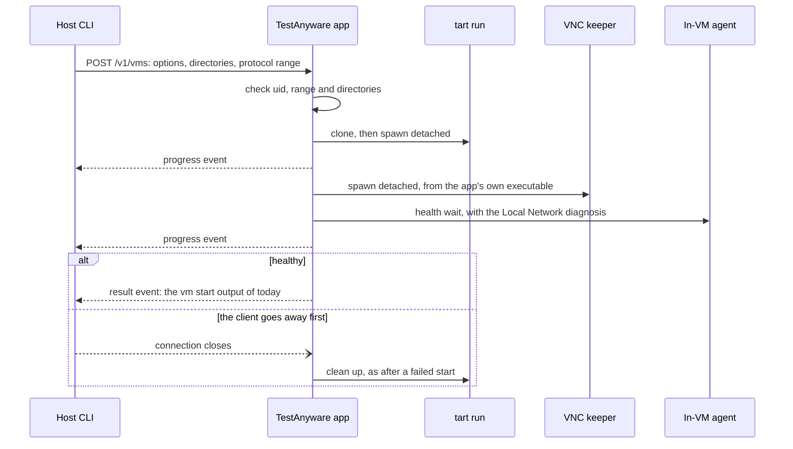

### Lifecycle and adoption

The app runs `vm start`, `vm stop`, `vm list` and `vm delete` with the
lifecycle code that the Host CLI runs on other hosts. It starts `tart run`,
QEMU, swtpm and the VNC keeper detached in their own sessions, as `vm start` does
today. While the app runs, it reaps each of its children that exits. Each
child outlives the app, as the measurements show. The app starts each VNC
keeper from its own executable, so a keeper always matches the app's version.
The executable answers the hidden command `_vnc-keeper` that the keeper runs.

A detached child holds no descriptor of the app. On macOS a new socket gets
close-on-exec in a second call. So a `fork` on another thread could hand a
child a client socket that another thread has just accepted. The app starts
`tart run`, QEMU, the keeper and `swtpm` with `posix_spawn` and
`POSIX_SPAWN_CLOEXEC_DEFAULT`, which closes every descriptor that a file action
does not name. A thread waits for each child, so none stays a zombie.

The state directory stays the record of each VM, in the spec and meta sidecars
of today. A start record also lives there while a start runs. After a crash it
stays until the app decides for it, so the app can remove a start that the
crash interrupted (`docs/specs/admission-queue.md`). The
app keeps no other VM state across a restart.

Adoption is how the app serves again a VM that it did not start in its
current run. When the app starts, it reads each sidecar and checks each
recorded process by its identity. Then it serves each live VM again. A VM that an
older Host CLI started has the same sidecars, so the app adopts it in the
same way.

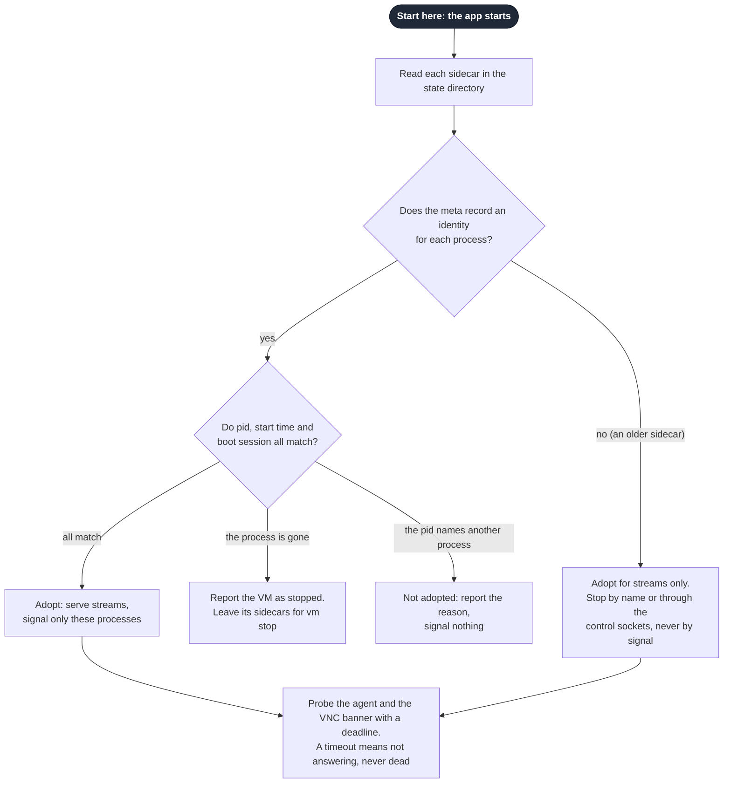

The rules of adoption:

- The meta records the pid, the start time and the boot session UUID of each
  process that it names. The app sends a signal to a process only when all
  three match. It writes the meta atomically.
- The meta of a QEMU guest also records its session directory. That directory
  holds the monitor socket and the control socket of swtpm.
- swtpm ends when its QEMU ends. The app starts swtpm with the option that ends
  it when its control connection closes. A start that fails before QEMU connects
  stops swtpm through its control socket.
- An older meta records no identity. The app serves the streams of such a
  VM, but it sends a signal to none of its processes. It stops a tart guest by
  name with `tart stop` and `tart delete`, and the VNC keeper then ends itself
  (ADR-0018).
- An older meta records no session directory either. The app looks for it by
  the VM id, as the older Host CLI named it. It looks first in its own
  temporary directory, and then in `/tmp`, which a starter with no `TMPDIR` used.
  A starter with another `TMPDIR` put it elsewhere, and the app does not find it.
- The app reads each sidecar in the state directory and decides for each VM. A meta
  that records no identity is an older meta. The app reports a VM whose process is
  gone as stopped. It reports a VM whose pid, start time or boot session differs as
  in doubt. Otherwise the app adopts the VM.
- The decision looks at the main process. The app compares the keeper and swtpm again
  at the moment of each signal, so a decision never authorises a later signal.
- The app probes the agent and the VNC banner of each adopted VM, each with a
  deadline of 8 seconds. A probe that gets no answer in time reports "not
  answering". That is never a statement that the guest is dead.
- The app does not probe the VNC port of a tart guest that no live keeper holds.
  The VNC server of macOS 27 aborts tart when a client connects 60 seconds or more
  after the last one left (ADR-0018). The probe reports "not probed".
- `vm stop` signals a process only on a full match of the pid, the start time and
  the boot session. This holds on the direct path too, for a meta with an identity.
  When the identity does not match, `vm stop` signals nothing. It removes neither
  the clone, the session directory nor the sidecars. It fails with `VM_STOP_FAILED`.
- A failed adoption never stops, kills or starts a VM again. The app
  reports the VM as not adopted, with the reason, in `GET /v1/status` and in its
  menu. The VM keeps running.
- The app serves its socket before it probes the survivors. So a survivor
  that answers nothing never delays the app.
- `GET /v1/status` holds the field `adoption`. Its `finished` member is false until
  every probe ends. Its `adopted` list names each VM with `legacy`, `agent` and
  `vnc`, and each answer is `pending`, `answering`, `not_answering` or `not_probed`.
  Its `not_adopted` list names each VM with a `reason` and a `detail`. The reasons are
  `process_gone`, `start_time_differs`, `boot_session_differs`, `no_boot_session` and
  `meta_unreadable`. Its `unfinished_starts` list names each start record that the app
  found, with `removed` and a `detail` (`docs/specs/admission-queue.md`). When tart did
  not answer at the start of the app, the app decides again for the record after an
  observation whose `tart list` answered, and the new result replaces the first one for
  that VM. A client that needs the results asks again until `finished` is true.

An older QEMU guest stops through its control sockets, and never by a signal:

- When its monitor answers, the app sends `quit`. An orderly exit of QEMU also
  ends its swtpm.
- When the control socket of swtpm still answers after QEMU is gone, the app
  sends swtpm its shutdown command on that socket.
- The stop succeeds when neither socket answers and no process holds the
  clone's disk, within a bounded wait. Then the app removes the clone and
  session directories, and both sidecars.
- Otherwise the app removes nothing. The sidecars stay, so that a later
  `vm stop` can try again. The stop fails with `VM_STOP_FAILED`, and its details
  name what still answers or holds the disk. The remedy says to quit that QEMU
  by hand, and then to run `vm stop` again.

### Version skew

Protocol versions are integers. The admission queue added version 2 for its two
requests (`docs/specs/admission-queue.md`). The first release stated the range 1 to 1 on
both sides, and this release states 1 to 2. When the two ranges overlap, the pair
uses the highest common version.

When the ranges do not overlap, the command fails with `APP_INCOMPATIBLE`, cause
`protocol`. The error names both builds and both ranges, and one remedy. The
remedy is the `remediation` of the error, and `details.remedy` holds its name
(`quit_and_open_app`, `upgrade_cask` or `upgrade_host_cli`):

| Situation | Remedy in the error |
|---|---|
| The running app is older, and the installed bundle is newer | Quit TestAnyware from its menu, and open it again |
| The running app and its bundle are both older | `brew upgrade --cask testanyware-app` |
| The Host CLI is older | `brew upgrade testanyware` |

A command that needs a version above the app's range fails in the same way. The
commands that need version 2 are `vm slots` and the macOS `vm create-golden`.
With an app whose range ends at 1, each fails with `APP_INCOMPATIBLE`, cause
`protocol`. `vm start` still works as that app does, because the Host CLI states
the range 1 to 2 and the pair uses version 1.

The Host CLI learns the range of the app from the headers of the answer. An app
of version 1 answers the request for `/v1/slots` with 404, and its headers state
its range. A client that agreed on version 1 gets the same 404 from an app of
version 2.

A client never restarts the app, so no client stops an app that other
clients use. When the builds differ and the ranges overlap, the command
proceeds. The Host CLI then writes one notice line to stderr, in both output
modes. The notice names both builds and the remedy from the table above.

The notice changes neither stdout nor the JSON envelope. The progress lines of
`vm start --wait` use stderr in the same way. `--quiet` does not suppress the
notice. One command writes the notice once, however many connections it opens.
`doctor` also reports both builds, and whether the running app is older than its
bundle on disk.

One pure function decides, from the two ranges, the two builds and the build of
the bundle on disk. The app calls it to refuse a request, and the Host CLI calls
it on each response. The older side is the one with the lower range, or, when the
ranges overlap, the one with the lower build. A side that states no range is the
older one. When a build is missing or is no version, the app is the side to
change.

A bundle build that is missing or unreadable never counts as newer than
the running app. The remedy is then the cask upgrade. That upgrade quits the
app and opens it again.

`GET /v1/status` holds `bundle_build`, the build of the bundle on disk or `null`,
and `older_than_bundle`, which is true when that build is newer than the running
app's.

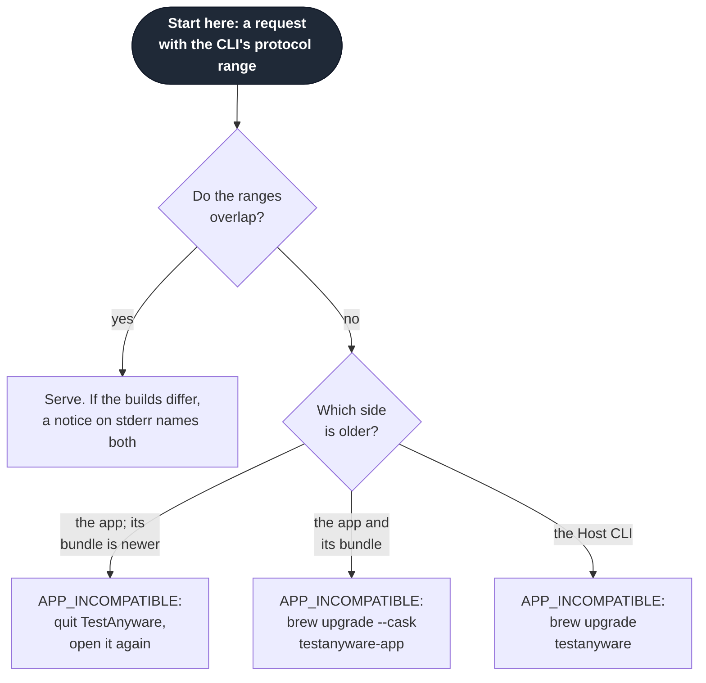

The app's protocol floor rises only in a major release. A cask upgrade quits and
opens the app again, so it leaves no old app running.

### The Local Network diagnosis

ADR-0019 records this decision. The app diagnoses a denial of each
connection that it makes to a guest:

- **The health wait of `vm start`** keeps the rule of today. After five
  `host_unreachable` probes in a row, it asks the platform `/usr/bin/nc`. If `nc`
  connects, the start fails with `VM_BOOT_TIMEOUT` and `details.cause`
  `local_network_denied`.
- **A guest stream** retries a `host_unreachable` dial for 5 s at most. A new
  executable UUID gave a refusal of about 2 s in the measurements. Then the app
  asks `nc`. The error is `CONNECTION_REFUSED`, with `details.cause`
  `local_network_denied` or `host_unreachable`. A try that fails with another
  error ends the dial at once. The window counts from the first try, and a try
  in progress runs to its end. So a denial takes about 8 s: three tries of
  about 2 s, then `nc`. One try has a limit of 10 s, and a try that passes it is
  `CONNECTION_TIMEOUT`.

The remedy names the app: allow TestAnyware in System Settings, Privacy &
Security, Local Network. A person does this once, and again when an upgrade
asks (ADR-0020). Before that grant, the first guest connection raises the
alert, and the command fails in about 8 s with this remedy. It does not wait
for a person to answer.

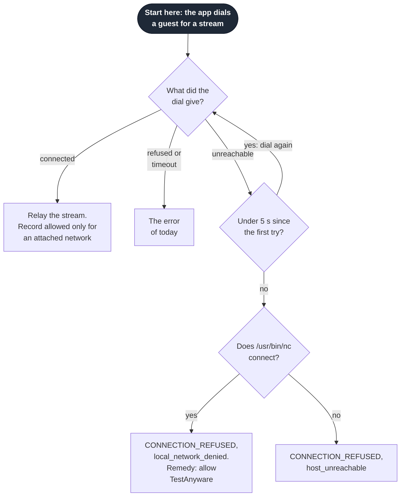

The app keeps its last observation of the grant for `doctor` and its menu,
with the destination and the time of the dial that made it. Only a dial to a
network that one of the host's interfaces attaches, other than loopback, changes
the observation. The tart guest subnet is such a network. A dial of that kind
that connects records allowed, and a denial that `nc` proves records denied. A
dial to loopback, or beyond the attached networks, leaves the observation as it
was. Before the first dial of that kind, the observation is not yet seen.

### Configuration

ADR-0021 records this decision. One optional file,
`~/.config/testanyware/config.rhai`, configures the TestAnyware app and the Host
CLI. Only `TESTANYWARE_CONFIG` names another file or `none`. A test uses it, and
the remedy of `CONFIG_INVALID` names `TESTANYWARE_CONFIG=none` for one command
without the file. The login item gives the app no shell environment, so in
normal use only the Host CLI reads the variable. The live check of the bundle
sets it in the environment in which it opens the app.

- The Host CLI and the app evaluate the file with one shared evaluator and the
  same limits. The script has no access to files, processes or the network, and
  it runs under an operation limit.
- The script's value is a map of settings. The settings are `tools`, with the
  locations of `tart`, `qemu-system-aarch64` and `swtpm`, and `state_dir` and
  `data_dir`. `macos_slots` lowers the app's share of the macOS guest slots
  (`docs/specs/admission-queue.md`). An unknown key is an error, and so is an
  unknown tool.
- `macos_slots` is an integer, as the queue's spec states. Each other setting is
  a path: a string that holds an absolute path. A relative path would mean
  another place for each working directory. `state_dir` is the state directory
  itself, the one that holds `vms/`. `data_dir` is the data directory itself, the
  one that holds `golden/`. Neither is a replacement for `XDG_STATE_HOME` or
  `XDG_DATA_HOME`. Those two get `testanyware` appended.
- The Host CLI finds a tool that the file names at that location or not at all.
  The search of the host does not stand in for a wrong location.
- The app takes every setting. The Host CLI takes the directories on every host.
  It takes the tool locations where it runs the tools itself: on Linux and
  Windows hosts, and for golden creation. It checks `macos_slots`, as the
  shared evaluator does, and it does not use it.
- In the Host CLI, a flag beats an environment variable, which beats the file,
  which beats the built-in default. In the app, the file beats the built-in
  default. The app's built-in tool search covers `/opt/homebrew/bin`,
  `/usr/local/bin` and `/usr/bin`.

When the app starts and finds no entry at `~/.config/testanyware/config.rhai`,
it writes a file there, and then it evaluates the file (ADR-0021). The file
changes no setting, so each command behaves as it does with no file.

- The file holds comments and an empty map, `#{}`, as its value. A file of
  comments alone fails to evaluate, because its value is not a map.
- The comments say that TestAnyware wrote the file and that the Host CLI and the
  app both read it. They say that the app reads it only when it starts.
- The comments name each setting with an example line that starts with `//`.
  The examples of `state_dir` and `data_dir` name the built-in directories under
  the user's home. The example of `tools` names each tool in `/opt/homebrew/bin`,
  and its comment names the app's built-in search. Each example evaluates when a
  person removes its `//`.
- The app never replaces an entry at the path, and a dangling symlink is an
  entry. A person never sees a partial file at the path. The app creates a
  missing directory.
- The write comes before the fingerprint and the read. So the app evaluates the
  file that it wrote, `changed_since_evaluation` stays false, and the menu asks
  for no restart.
- When the write fails, the app runs as with no file. It reports the failure on
  its standard error, and the status gains no field.
- The app writes the file again at a later start, after a person removes it.
- Only a normal run of the app writes, and only at the default place. It never
  writes a file that `TESTANYWARE_CONFIG` names. A test-mode run writes nothing.
  The Host CLI never writes the file, so a Linux or Windows host gets no written
  file.

The app evaluates the file when it starts, and a restart of the app reloads it.
If the file fails to evaluate, the app runs with its built-in defaults. It
reports the error in its menu and through `doctor`. The Host CLI refuses to run
with a file that fails, with `CONFIG_INVALID`, the file, the line and the
message.

`GET /v1/status` holds the field `configuration`:

- `state` is `loaded`, `absent` (no file at the place the app looked), `failed`
  or `disabled` (`TESTANYWARE_CONFIG=none`, or no home directory). At the default
  place, a normal run reports `absent` only after a failed write.
- `file` is the path the app looked for, or `null` for `disabled`.
- `evaluated_at` is the time of the evaluation, in seconds since the Unix epoch,
  or `null` for `disabled`.
- `changed_since_evaluation` is true when the file on disk is not the one the app
  evaluated. The app compares the length and the modification time of the file
  that it saw just before it read the text. An edit, a new file and a removed
  file each count. Only a restart of the app reads the file again.
- `error` is the `CONFIG_INVALID` object of a file that failed, and `null`
  otherwise.

The menu shows the file, the time of the last evaluation and any error, which
names the line when Rhai places one. When the file changed since the evaluation,
the menu says to quit and open TestAnyware. An item opens the file in the text
editor when a file is there, whether it evaluated or failed.

The error object of `CONFIG_INVALID` carries `details.file`, `details.line` and
`details.message`. The line is `null` for a wrong type or an unknown key, because
the script finishes before the evaluator reads its value. Its remedy names the
file and `TESTANYWARE_CONFIG=none`.

`doctor` is the one command that runs with a file that fails. Its `config`
check fails with the `CONFIG_INVALID` error object. Its other checks use the
values that resolve without the file. The internal keeper that `vm start` spawns
is not a command of the contract, and it ignores the file.

Each request names the directories that the Host CLI resolved. When they differ
from the app's directories, the command fails with `APP_INCOMPATIBLE` and
`details.cause` `directories`. The error names both pairs of directories. Its
remedy names `config.rhai`, the variable that differs, and a restart of the app
when the app evaluated an older file. The one exception is `GET /v1/status`,
which `doctor` sends.

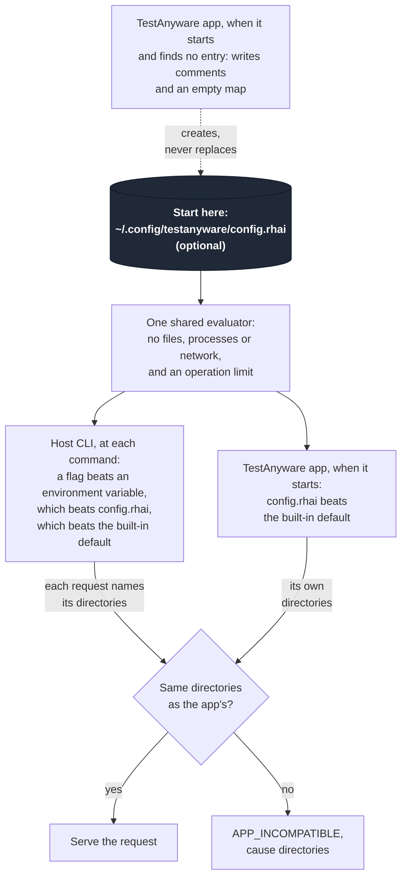

### New error codes

| Code | Exit | When |
|---|---|---|
| `APP_NOT_INSTALLED` | 1 | Nothing answers on the default socket, and `/Applications` and `~/Applications` hold no `TestAnyware.app`. `details.searched` lists both paths. The remedy is the setup. A socket that `TESTANYWARE_APP_SOCKET` names never gives this error, because that app need not be in either place |
| `APP_UNREACHABLE` | 1 | The Host CLI cannot use the app's socket. `details.cause` is `not_running` (the socket is missing or refuses the connection), `unsafe_socket_directory`, `quitting` (the app closed the connection before it answered), `socket_path_too_long` or `socket_error` (another failure, with `details.errno` where there is one) |
| `APP_INCOMPATIBLE` | 1 | `details.cause` is `protocol` or `directories` |
| `CONFIG_INVALID` | 2 | `config.rhai` fails to evaluate, or it names an unknown key |

Each existing code keeps its meaning and its exit code.

### What the commands report about the app

- **`doctor`** gains an `app` check on a macOS host. It reports whether the app
  is installed, with its path and version, and whether it runs, with its build
  and protocol range. It reports the login item's status, the Local Network
  observation, the configuration, each VM that was not adopted, and whether the
  directories match. Each failing item carries a remedy. On a Linux or Windows
  host, the check reports that it does not apply. A `config` check on every host
  reports the Host CLI's own evaluation of the file. A configuration error, a
  directory mismatch and a protocol mismatch are each a failing check in the
  report, not an error envelope. As today, a failing check makes `doctor` exit
  with 1.

  The `app` check holds one item for each fact above: `installed`, `running`,
  `login_item`, `local_network`, `configuration`, `adoption`, `directories`,
  `versions` and `bundle`. An item is `pass`, `warn`, `fail` or `skip`, and only
  `fail` flips the check.

  These fail:

  - no bundle while the app does not answer
  - an app that does not answer
  - a login item that is off or waits for approval
  - a denied grant
  - a configuration that failed
  - other directories
  - ranges that share no version

  These warn:

  - a bundle outside the two search paths while the app answers
  - a grant not yet seen
  - a file that changed after the evaluation
  - VMs that were not adopted or whose probes have not finished
  - builds that differ
  - an app older than its bundle

  When the app does not answer, `installed` and `running` report and every other
  item is `skip`. The remedy of a directory mismatch and of a protocol mismatch is
  the one the commands give in the same case. The schema
  `docs/reference/cli-schemas/doctor.json` documents each item.
- **`llm-instructions`** gains a section on the TestAnyware app. It covers the
  one-time setup by a person, and the rule that a client never starts the app.
  It also covers each error above with its remedy, and golden creation from
  Terminal.
- **`vm start --json` and `vm list --json`** gain no field. Each field keeps its
  meaning and its value. An endpoint in them is the guest's own endpoint, which
  on a macOS host only the app dials. A client hands back the id with `--vm`, or
  the endpoint with `--agent` or `--vnc`. The Host CLI routes either one through
  the app. A client that dials the endpoint itself does so outside TestAnyware.
  On a macOS host, that client's own process then meets the Local Network denial.

### How the host harnesses reach their guests

ADR-0009 records this decision. The Linux and Windows host harnesses run the
cross-built Host CLI inside a test VM, the host-under-test (HUT). That CLI drives
a macOS golden through a forward on the host. On a macOS host, each harness
reaches both VMs through the app:

- The harness starts each VM with `vm start`, which the app runs, and stops it
  with `vm stop`. The Linux HUT is the Linux golden, and the Windows HUT is the
  Windows golden.
- The Linux HUT is a tart guest. `vm start --platform linux` serves a same-named
  qcow2 with QEMU instead, so after the start the harness reads the HUT's
  `backend` from `vm list --json`. When it is not `tart`, the harness stops the
  HUT and fails, and it names the qcow2 as the cause. It does not change how
  `vm start` chooses a backend.
- The harness provisions the HUT through its In-VM agent, with `exec`, `upload`
  and `download`. The agent client gets each connection as a guest stream by the
  HUT's id. No harness uses SSH.
- The forward accepts each connection of the HUT on the host. For each one, it
  opens a guest stream by the golden's id, of the agent kind or the VNC kind. It
  dials no guest. macOS needs no Local Network access to accept a connection
  (Apple TN3179).
- The harness reads the golden's spec only for the VNC password, as the Host
  CLI does for `--vm`. It reads no endpoint from a spec.
- The harness builds no request path and no header. The Host CLI's own library
  builds the agent client and opens each guest stream. The `testanyware` binary
  runs the same code, so the harness changes no flag, exit code or `--json`
  field.

The forward is the one TCP listener that this design adds. It keeps the one-user
rule as far as a listener can:

- It binds only the address that the HUT dials, and never every interface. For
  a tart HUT, that is the host's address on the guest bridge, which is the
  HUT's default gateway. For a QEMU HUT, it is `127.0.0.1`, because QEMU's user
  network delivers the gateway `10.0.2.2` to the host's loopback. The Linux HUT
  is always tart, so only the Windows HUT is a QEMU HUT.
- For a tart HUT, it accepts a connection only from the HUT's own address, the
  source address of the HUT's default route. It closes any other connection and
  opens no stream.
- It lives for one harness run.

During a run of the Windows harness, a process of another local user can reach
the forward on loopback. Through it, that process reaches the macOS golden's
agent and VNC by the harness's own guest streams. The owner accepted this
exception to the one-user rule on 2026-10-21, with these limits:

- It applies only to a manual run of the Windows host harness. No release runs
  that harness, because the owner decided on 2026-10-21 to ship no Windows host
  binary.
- The forward listens on loopback only, and only for one run.
- It reaches only the agent and the VNC endpoint of the one macOS golden. It
  cannot start a VM, name an endpoint or reach another VM.

During the same run, QEMU forwards the Windows HUT's own agent on every
interface. That exposure is wider, and "Open risks" already names it. Before
this design, the forwards of both harnesses listened on `0.0.0.0`. A rejected
option checked that the HUT's QEMU process owns each connection, through
`/usr/sbin/lsof`. It costs more than the bounded exception, for a harness that
no release runs.

The Linux golden is a desktop image, so it holds libraries that a server lacks.
Such a library could hide a dependency that a server cannot meet. So the Linux
harness checks two sets of native libraries:

- Before it stages the binary, it reads the shared libraries that the binary
  and its bundled libraries need at load time. It fails when one of them is
  neither a bundled library nor a part of the C runtime. The C runtime is
  `libc`, `libm`, `libpthread`, `libdl`, `libgcc_s` and the dynamic loader.
- After it provisions the OCR venv, it reads the shared libraries that each
  native library in the venv needs at load time. It fails when one of them
  resolves outside the venv and is not a part of the C or C++ runtime. The C++
  runtime is `libstdc++`. The release's Linux formula installs EasyOCR into a
  venv too. So this check keeps what the stock server proved for the OCR band.

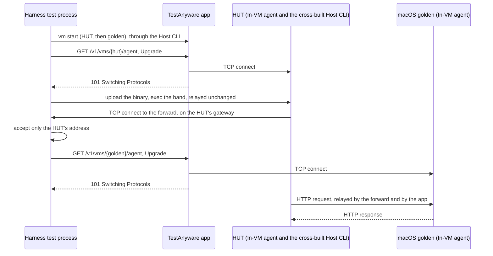

### Golden creation keeps its direct path

`vm create-golden` runs in the Host CLI on every host, as today. It connects to
the guest itself, through SSH, RFB and the agent, and it does not use the app for
that traffic. When the app runs, golden creation asks it for a macOS guest slot
(`docs/specs/admission-queue.md`).
On a macOS host it needs a context with Local Network access, such as
Terminal. Under herdr it fails as it does today.

It is the one traffic on a macOS host that the app does not carry. The owner
keeps it direct, because golden creation is a manual operation. A person or an
LLM runs it from a `.command` file, which Terminal opens, so it runs with
Terminal's Local Network access. TestAnyware builds no helper for that file. The
live tests of the parts of golden creation dial their guests directly too, and
they also run from Terminal.

Golden creation sends one request at most: the hold of a slot, when the app
runs. That request carries the directories, as every request does. When the app
does not run, golden creation sends no request, and nothing compares the
directories.

So on a macOS host, golden creation compares them itself, before it starts. It
resolves the directories that the app resolves: those of `config.rhai`, else
the built-in defaults, with no flag and no variable. When its own directories
differ, it fails with `APP_INCOMPATIBLE`, `details.cause` `directories` and the
same remedy. This check needs no running app.

### Linux and Windows hosts

A Linux or Windows host has no TestAnyware app. The Host CLI keeps the direct
path of today for every command. `config.rhai` applies there too, and no
process writes it there.

### Documents that the implementation corrects

The code survey of 2026-10-20 found documents that this design changes, or that
were wrong. The implementation corrected them:

- `docs/reference/connection-spec.md` describes the `<id>.json` file as a
  contract for direct readers. It stops being one. It also calls the QEMU VNC
  endpoint "LAN", but QEMU listens on `localhost`.
- `docs/user/multi-vm-networking.md` puts the QEMU agent at `<vm-ip>:8648`, but
  QEMU forwards it from `localhost`.
- The doc comment of the target resolution, and `docs/reference/env-vars.md`,
  put `--agent` and `--vnc` before `TESTANYWARE_VM_ID`. The code puts the
  variable first.
- The list of error codes in the command surface omits `AGENT_INVALID_JSON`,
  which the agent client returns.
- `docs/architecture/cli-design-contract.md` binds the command surface. Its
  amendment for the Local Network denial says that the remedy is to run
  testanyware from an app with Local Network access. On a macOS host, the
  remedy names the TestAnyware app instead (ADR-0019). The contract's catalogue
  of error codes also gains the codes of "New error codes" above. The dated
  research documents stay as evidence, unchanged.
- The same order of the resolution chain appears in `LLM_INSTRUCTIONS.md` and in
  `docs/reference/cli-commands.md`. Both now put `TESTANYWARE_VM_ID` before
  `--agent` and `--vnc`.
- `LLM_INSTRUCTIONS.md` and `docs/reference/env-vars.md` said that
  `TESTANYWARE_AGENT` overrides the spec file. It never did, because a spec file
  comes first in the chain.
- No document listed `VM_HOST_UNSUPPORTED`. A test now compares each code of the
  catalogue and each public variable of `capabilities` with the documents.

## Requirements

### Requirement: Every guest connection on a macOS host goes through the app

On a macOS host, only the app and the processes that it starts SHALL carry
traffic to a guest, except in golden creation.

#### Scenario: An agent command from herdr

- **WHEN** an agent under herdr runs `agent snapshot --vm <id>` after the setup
- **THEN** the command succeeds through a guest stream, and the output matches the
  output of today

#### Scenario: An explicit endpoint

- **WHEN** a command names `--agent <host>:<port>` on a macOS host
- **THEN** the Host CLI asks the app for a stream to that endpoint, and it
  dials nothing itself

#### Scenario: The app is not running

- **WHEN** any command that needs the app runs and nothing answers on its socket
- **THEN** the command fails with `APP_UNREACHABLE`, names the remedy, and makes
  no direct connection

#### Scenario: A stream to a VM that the app does not hold

- **WHEN** a client asks for a stream by a VM id that has no spec in the state
  directory
- **THEN** the request fails with `VM_NOT_FOUND`, and the app dials nothing

#### Scenario: The Linux host harness without a grant of its own

- **WHEN** the Linux host harness runs from a session that has no Local Network
  access, and a person allowed the app
- **THEN** the harness passes, and its test process opens no connection to a
  guest

#### Scenario: A connection to the forward from another address

- **WHEN** a process at an address other than the tart HUT's connects to the
  forward of the Linux host harness
- **THEN** the forward closes the connection and opens no guest stream

#### Scenario: A Linux HUT that QEMU serves

- **WHEN** a same-named qcow2 makes `vm start --platform linux` choose QEMU for
  the Linux host harness
- **THEN** the harness stops the HUT, opens no forward, and fails with a message
  that names the qcow2

### Requirement: No client starts the app

The Host CLI SHALL never start the TestAnyware app.

#### Scenario: The app was quit

- **WHEN** a person quits the app and an agent then runs `vm list`
- **THEN** the command fails with `APP_UNREACHABLE` and `details.cause`
  `not_running`, and the app stays quit

### Requirement: Only the user who runs the app reaches it

The app SHALL serve only connections whose peer uid is its own.

The forward of the Windows host harness is the one exception that the owner
accepted. During a manual run, another local user reaches the macOS golden
through it. "How the host harnesses reach their guests" states its limits.

#### Scenario: Another user connects

- **WHEN** a process of another local user connects to the socket
- **THEN** the app closes the connection and serves nothing

#### Scenario: Another user owns the socket directory

- **WHEN** the socket directory belongs to another user
- **THEN** the app refuses to serve, and the Host CLI fails with
  `APP_UNREACHABLE` and `details.cause` `unsafe_socket_directory`

### Requirement: VMs outlive the app

A quit, a crash or an upgrade of the app SHALL leave each running VM running.
When the app starts, it SHALL adopt each VM that its identity rules allow.

#### Scenario: A quit and a new start

- **WHEN** a person quits the app while a VM runs, and then opens the app
- **THEN** `vm list` shows the VM, and an agent command reaches it

#### Scenario: A recorded pid names another process

- **WHEN** a meta records a pid whose start time differs from the live process
- **THEN** the app reports the VM as not adopted and signals nothing

#### Scenario: An older QEMU guest that does not stop

- **WHEN** `vm stop` names a QEMU guest of an older meta, and its monitor does
  not answer while a process holds its disk
- **THEN** the stop fails with `VM_STOP_FAILED`, signals nothing, and keeps the
  sidecars and the clone

### Requirement: A version mismatch is never silent

When the protocol ranges do not overlap, the command SHALL fail with
`APP_INCOMPATIBLE` and a remedy. When the builds differ and the ranges overlap,
the Host CLI SHALL write a notice to stderr.

#### Scenario: The running app is older than its bundle

- **WHEN** the running app's range is below the Host CLI's, and the bundle on
  disk is newer
- **THEN** the command fails, names both builds, and says to quit and open
  TestAnyware

#### Scenario: Builds that differ, with ranges that overlap

- **WHEN** the Host CLI's build differs from the running app's, and their
  protocol ranges overlap
- **THEN** the command succeeds with the stdout of today, and one line on stderr
  names both builds and the remedy

### Requirement: A Local Network denial names the app

The app SHALL diagnose a denial of its own guest connections, and the
remedy SHALL name the TestAnyware app.

#### Scenario: Before the first grant

- **WHEN** an agent runs `vm start --platform macos` before a person allows the
  alert
- **THEN** the start fails with `VM_BOOT_TIMEOUT` and `details.cause`
  `local_network_denied` in about 8 s after the guest's address appears, and the
  remedy names TestAnyware

#### Scenario: A loopback connection after a denial

- **WHEN** the app proved a denial on a tart guest, and a stream to a loopback
  endpoint then connects
- **THEN** the grant observation stays denied, with the destination and the time
  of the denial

### Requirement: An upgrade keeps the app's identity

A cask upgrade of the app SHALL keep its bundle id and its signing identity.
After an upgrade, no command SHALL wait for a person.

#### Scenario: An upgrade through Homebrew

- **WHEN** `brew upgrade --cask testanyware-app` installs a new release, and a
  command then reaches a tart guest
- **THEN** no "downloaded from the Internet" dialog appears, and System Settings
  shows one TestAnyware row
- **AND** the command succeeds within the retry of a guest stream, or it fails
  with `local_network_denied` and a remedy that names TestAnyware

### Requirement: One configuration file

The Host CLI and the app SHALL evaluate `config.rhai` with one evaluator.

#### Scenario: A file that fails

- **WHEN** `config.rhai` has a syntax error
- **THEN** each command except `doctor` fails with `CONFIG_INVALID` and the
  line, and the app runs with its defaults and shows the error in its menu

#### Scenario: Directories that differ

- **WHEN** the Host CLI resolves a state directory that differs from the app's
- **THEN** the command fails with `APP_INCOMPATIBLE`, `details.cause`
  `directories`, both directories and the remedy

#### Scenario: Golden creation with directories that differ

- **WHEN** `vm create-golden` runs on a macOS host with `XDG_DATA_HOME` set to a
  directory other than the default, and `config.rhai` names no `data_dir`
- **THEN** it fails with `APP_INCOMPATIBLE` and `details.cause` `directories`
  before it starts, whether the app runs or not

### Requirement: The app writes the file when it finds none

When a normal run of the app starts and finds no entry at the default place, it
SHALL write a file that changes no setting. It SHALL never replace an entry.

#### Scenario: A first start with no file

- **WHEN** the app starts and `~/.config/testanyware/config.rhai` does not exist
- **THEN** the file holds comments and an empty map, and `GET /v1/status`
  reports `configuration.state` `loaded` and `changed_since_evaluation` false,
  and each command resolves the settings that it resolves with no file

#### Scenario: A file is there

- **WHEN** the app starts and the file exists, whether it evaluates or fails
- **THEN** the app leaves the file as it is

#### Scenario: A test-mode run

- **WHEN** the app starts in its test mode, and no file is at its `--config` path
- **THEN** it writes nothing, and its status reports `absent`

#### Scenario: The write fails

- **WHEN** the app cannot write the file
- **THEN** it runs with its built-in defaults, its status reports `absent`, and
  it reports the failure on its standard error

### Requirement: doctor reports the failures that it diagnoses

`doctor` SHALL report a configuration error, a directory mismatch and a
protocol mismatch as failing checks, and it SHALL exit with 1.

#### Scenario: doctor with a file that fails

- **WHEN** `config.rhai` has a syntax error, and a person runs `doctor`
- **THEN** its `config` check fails with the `CONFIG_INVALID` error object, and
  its `app` check still reports the running app

#### Scenario: doctor with directories that differ

- **WHEN** the Host CLI's state directory differs from the app's, and a person
  runs `doctor`
- **THEN** its `app` check fails, names both directories and gives the remedy

### Requirement: Linux and Windows hosts keep the direct path

The Host CLI SHALL reach guests directly on a Linux or Windows host.

#### Scenario: A Linux host

- **WHEN** a command reaches a guest on a Linux host
- **THEN** it connects as it does today, and it needs no app

## Test seams

The human agreed these three seams in `plan-k1`.

- **The protocol of the app**, the one new seam. A test starts the app's
  executable in its test mode. That mode has no status item, no login item and
  no LaunchServices. It takes a temporary socket, state directory, data
  directory and configuration file. The test drives it with the real Host CLI
  binary through `TESTANYWARE_APP_SOCKET` and `TESTANYWARE_CONFIG`, two
  variables for tests. The guests are fakes on loopback: a wiremock In-VM agent
  and a synthetic RFB server. The test writes the sidecars that name them.

  This seam covers guest streams, a half-close, a large transfer and `vm list`.
  It covers `vm stop` and `vm delete`: the VM's processes are `sleep` commands
  that the test orphans, and a fake `tart` logs each call that it gets.

  It covers `vm start` against a fake `tart`: a clone is a file, and a running VM
  is a `sleep`. The test-mode argument `--test-agent-port` moves the agent port of
  a start. It points the probes at a fake agent, or at a port that refuses.
  A start then stays in its agent wait until the test closes its connection.

  It covers adoption from sidecars, the version handshake, the skew notice, and
  the uid and directory checks. It also covers the directory refusal, the
  configuration errors and how each error maps to the envelope. It covers
  `doctor` with a file that fails, and with directories that differ. The agent
  client runs here on guest streams, and its existing tests run it on TCP.

  It covers the end of a guest stream. The real Host CLI runs 40 VNC commands
  against a synthetic RFB guest that keeps its connection after the client's
  end, as tart does. The test is `many_vnc_commands_leave_the_descriptors_of_the_app_flat`
  in `app-vnc-routing`. The app's descriptors stay flat, and the guest sees a
  reset on each connection.

  It also covers the delivery of input. A synthetic RFB guest reads one message
  in each 100 ms, as tart reads late, and it drops all that it has not read when
  a reset has reached its connection by then. The real Host CLI runs `input
  click` and `input type` through the real app against it. When the command
  returns, the guest must hold every event. The tests are
  `a_click_has_reached_a_guest_that_reads_late_when_the_command_returns` and
  `typed_text_has_reached_a_guest_that_reads_late_when_the_command_returns` in
  `app-vnc-routing`. Both fail when the client closes without the wait.
- **The existing seams of pure functions and injected probes**, for decisions
  inside the app. These are adoption by identity, the skew decision and
  the Local Network diagnosis of a guest stream. They also include the grant
  observation and the stop of an older QEMU guest. The last are the order of
  configuration sources, the directory check of golden creation and the checks
  of the socket path. The seam also holds four decisions of the host harnesses.
  They are the address that the forward binds and its check of a connection's
  address. The others are the backend check of the Linux HUT, and the check of
  the libraries that the Linux binary and the OCR venv need.

  The relay of a guest stream is one such seam. Its unit tests run it on
  in-memory pipes and on real sockets. They cover a half-close in both
  directions and a client that closes after its last message. They also cover a
  client that has gone while the guest stays silent, and the reset of the guest
  connection. The watch that tells a client that has gone from a half-close runs
  on a pair of Unix sockets.

  The text of the written `config.rhai` is a pure function of the home
  directory. Its tests evaluate the text to no setting. They remove the `//` of
  each example and evaluate the text again, and they find each key of the
  evaluator in the text. The write step has a unit test in a temporary
  directory. It writes when no entry is there, and it never replaces a file or
  a dangling symlink. The protocol seam's test that a test-mode run reads no
  file of the user also proves that such a run writes none.
- **The existing Taskfile live checks**, for seven runs on this Mac:
  - The herdr acceptance run. From a herdr session, a macOS guest starts. An
    agent, screen, input and file command each act on it, and it stops. Each
    step goes through the app.
  - An upgrade keeps the app's identity. Release N is installed and allowed,
    then the cask installs release N+1. The first command to a tart guest
    succeeds, or it fails with the denial that names TestAnyware. After a person
    allows the app again, the command succeeds, and System Settings shows one
    TestAnyware row. `release:upgrade-check` runs it on a release candidate and
    a throwaway release with a lower version, and `release:upgrade-check-clean`
    removes the throwaway.
  - VMs survive a quit of the app, and the app adopts them when it opens again.
  - The end of a guest stream. 150 VNC commands go to a running tart guest
    through the development bundle. The app's descriptors and the connections
    that tart holds in `CLOSE_WAIT` stay flat. `app:stream-end-live` runs it.
  - The Linux host harness passes from a session that has no Local Network
    access of its own, with the app allowed. `release:linux-harness` runs it on
    a candidate.
  - The admission queue. Three `vm start --wait` run from three shells, and the
    third waits until a stop of the first admits it. A `tart run` outside the
    app holds a slot, and `vm slots` names it as external. A golden creation
    waits for its slot, and Ctrl-C ends the wait and changes nothing.
    `queue:live` runs it, and it takes `APP=<bundle>` for a candidate.
  - The input commands. A fixture window in a macOS 27 guest holds a text field
    and a scroll view taller than its window. `input click` must focus the field,
    and `input type` must put text in it. `input scroll` and then `input drag` of
    the scroll-bar thumb must each move one element of the view. Each check reads
    its effect through `agent snapshot`, never the exit status of the command, and
    an oracle with `agent set-value` first shows that the agent reads the field.
    `input:live` runs it, and it takes `APP=<bundle>` for a candidate.

  Release 2.7.0 carries the change for GitHub issue 12. The tag `v2.7.0` names
  the commit `65bc05c9`. The GitHub release and `linkuistics/taps` hold the
  artifacts of that build.

  `task input:live` passed both checks twice on this Mac. The first run used
  the bundle and the Host CLI of the candidate. The second run used the
  installed release, after `brew upgrade` of the formula and of the cask. The
  checks `queue:live`, the herdr acceptance run and the Linux host harness
  passed on the candidate too.

## Open risks

- **An alert after an upgrade.** At one upgrade in three with a new UUID, macOS
  raised the alert again, and nothing explains which one. Each row of the
  measurements ran once. The live check of the release build also ran once. A
  person approved one alert in that run and could not say which build raised
  it. The adoption probes of the new app and its first command succeeded at
  once, so the grant needed no second approval after that upgrade. One run gives
  no rate. The real upgrade of this Mac from 2.4.0 to 2.5.0 is a second sample
  with a new UUID: no command failed with the denial. Two runs still give no
  rate. The owner accepts that a person may allow the app again after an
  update (ADR-0020).
- **A client's `TART_HOME`.** tart reads this variable to find its storage, and
  so its macOS goldens. The app runs tart with its own environment, so a
  client's `TART_HOME` reaches only golden creation. TestAnyware documents no
  such variable, and nothing checks it.
- **A login item that waits for approval.** Koine never observed the status
  `requiresApproval`. `doctor` reports it with a remedy.
- **No deep link to the Local Network row.** On macOS 27.0.1 no anchor of System
  Settings reaches the row. The menu item "Open Local Network Settings…" opens
  Privacy & Security, where the person selects Local Network. The Privacy
  extension has anchors such as `Privacy_Camera` and none for Local Network.
  The URL stays in one constant, so a later macOS release can improve the item.
- **A silent stall of every stream.** This is the most frequent failure of a
  relay in the survey. One dial for each stream and the Host CLI's own timeouts bound it.
  This delivery adds no watchdog.

  The end of a guest stream covers a client that has gone while the guest
  keeps its direction. It does not cover two other stalls. In the first, the
  guest stops reading and the app blocks on a write to it. The app then does not
  look at the client again, so a client that has gone leaves the stream open.

  In the second, the guest goes silent while the client stays. The app sets no
  timeout on an open stream. No run has shown either stall.
- **Guest endpoints on every interface.** QEMU forwards the agent port with no
  host address, and tart's VNC listened on a wildcard socket in the
  measurements. The agent's `/exec` may be reachable from the LAN. This is not
  the app's exposure, but it undermines the one-user boundary. The Windows HUT
  is such a guest during a run of the Windows host harness.
- **Timeouts of today.** The agent client's total timeout of 30 s ends an
  `agent wait` or a file transfer that runs longer. A guest stream changes
  nothing about that.
- **The Linux golden as the test VM.** The Linux host harness now needs the
  tart Linux golden, which a person builds from Terminal. The library checks
  cover what the binary and the OCR venv need at load time. A library that
  either opens later with `dlopen` is outside the checks. A run on the stock
  server proved such a library of the OCR band too, and a run on the golden
  cannot. No band of the harness runs the embedded viewer, which opens the
  Vulkan stack in this way. The checks cover the wheels that the harness
  installs, not the pinned set of the Linux formula.

## Out of scope

- **Issues #10, #4 and #5:** leases, more hosts and placement. The app is the
  one point of admission on a host, and `config.rhai` can gain policy functions
  later. The admission queue of issue #7 has a spec of its own,
  `docs/specs/admission-queue.md`.
- **Golden creation through the app.** The owner keeps its guest traffic
  direct, because a person or an LLM runs it from Terminal. It asks the app only
  for a slot.
- **A helper that writes and opens the `.command` file of golden creation.** It
  is a later delivery, if the owner asks for it.
- **A stream to another port of a VM, such as SSH.** No client needs one.
- **The TestAnyware app on Linux or Windows hosts.** Those hosts have no Local Network
  privacy.
- **A `launchd` daemon or a root helper.** TN3179 exempts both, but the human
  chose an app that the user grants.
- **The system defaults of macOS 15.5 that exempt a network.** They need `sudo`,
  and nobody has tested them on the tart bridge.
- **A restart after a crash.** Koine promises none, and this app follows Koine.
- **A code-signature check of the Host CLI.** The survey found no gain at the
  boundary of one user.
- **A Local Network diagnosis for the SSH of golden creation.** It has none today.
- **Multiplexed streams, pooled guest connections and a stall watchdog.**
